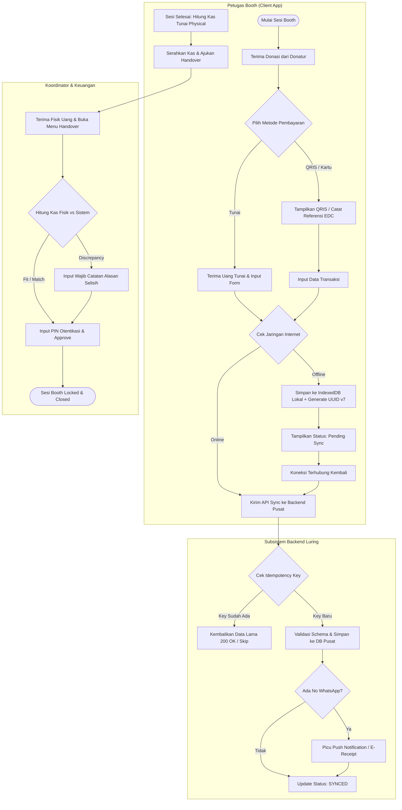

# SOFTWARE REQUIREMENTS SPECIFICATION (SRS)

## Subsistem Penerimaan Donasi Luring — Baitulmal Tazkia (BMTZ)

* **ID Dokumen:** BMTZ-SRS-OFFLINE-001
* **Versi Baseline Candidate:** 1.0.0 (Full Specification)
* **Tanggal:** 4 November 2026
* **Organisasi:** Baitulmal Tazkia (BMTZ)
* **Kelompok:** Kelompok 6 — Klaster Kanal dan Luring
* **Program Studi:** Sistem Informasi STMIK Tazkia (Gasal 2026/2027)
* **Standar Acuan Utama:** ISO/IEC/IEEE 29148:2018 (subklausul 8.5.2 & 9.6)
* **Acuan Kualitas Tambahan:** ISO/IEC 25010:2023 & UU No. 27 Tahun 2022 (PDP)

---

### Kontrol Dokumen & Riwayat Versi

| Versi | Tanggal | Deskripsi Perubahan | Penulis / Peran | Status Approval |
| :--- | :--- | :--- | :--- | :--- |
| **0.1** | 21/10/2026 | Draf awal struktur ISO 29148 berbasis analisis awal workbook. | Tim Analis Kelompok 6 | Draft Review |
| **0.9** | 04/11/2026 | Pelengkapan Notasi BPMN XML, Kamus Data Rinci, UI Mockup, & NFR Terukur. | Tim Analis Kelompok 6 | Internal Review |
| **1.0.0** | 04/11/2026 | Pembekuan Baseline Candidate SRS Minggu 4 untuk Walkthrough PIC & Dosen. | Kelompok 6 & PIC BMTZ | Ready for Sign-Off |

### Persetujuan Dokumen (Sign-Off Record)

| Peran | Nama | Jabatan / Pihak | Status Persetujuan | Tanggal |
| :--- | :--- | :--- | :--- | :--- |
| **PIC Donasi & Operasional** | *Endy Muhardin / Staf BMTZ* | Stakeholder Baitulmal Tazkia | Menunggu Walkthrough | TBD |
| **Dosen Pembimbing / Penguji** | *Endy Muhardin* | STMIK Tazkia | Review Dosen | 04/11/2026 |
| **Ketua Kelompok 6** | *Perwakilan Mahasiswa* | Tim Pengembangan Luring | Disetujui | 04/11/2026 |
| **Arsitek Tim Pendamping** | *Tim Semester 5 (MISI.501)* | Tim Pendamping / Mentor | Review RC-1 | 04/11/2026 |

---

## 1. Pendahuluan

### 1.1 Tujuan Dokumen (Purpose)
Dokumen Software Requirements Specification (SRS) ini mendefinisikan secara menyeluruh kebutuhan fungsional dan nonfungsional dari **Subsistem Penerimaan Donasi Luring (Offline-First Donated Booth System)** Baitulmal Tazkia.

Dokumen ini disusun untuk memenuhi sasaran pembaca berikut:
1. **Dosen Penguji & Pembimbing (MISI.304 & MISI.305):** Sebagai bahan verifikasi kepatuhan terhadap standar ISO/IEC/IEEE 29148:2018 dan bukti pemenuhan CMMI Tingkat 3 (*Defined Process* pada *Process Area* Requirements Development/RD & Requirements Management/REQM).
2. **Pengembang / Tim Konstruksi (MISI.302 & MISI.303):** Sebagai masukan teknis utama penyusunan *Class Diagram*, *Sequence Diagram*, skema database ORM, REST API Contract, dan penulisan kode unit pengujian.
3. **Tim Pendamping Semester 5:** Sebagai acuan evaluasi arsitektur (*Review Checkpoint* RC-1 s.d. RC-6), integrasi platform deployment, dan audit keamanan.
4. **Klien / PIC Baitulmal Tazkia:** Sebagai landasan komitmen formal (*sign-off*) lingkup aplikasi yang disepakati untuk dibangun.

### 1.2 Ruang Lingkup Produk (Scope)

#### In-Scope (Di Dalam Lingkup Aplikasi):
1. **Pencatatan Donasi Offline-First:** Pencatatan donasi tunai, QRIS, dan kartu (EDC manual) pada perangkat petugas booth tanpa bergantung pada koneksi internet konstan.
2. **Sinkronisasi & Penanganan Antrean:** Antrean sinkronisasi data transaksi otomatis ke backend pusat saat jaringan pulih, dilengkapi *idempotency key* untuk mencegah data ganda.
3. **Serah Terima Kas Berjenjang:** Pencatatan dan verifikasi serah terima uang tunai fisik secara bertahap dari Petugas Booth $\rightarrow$ Koordinator Lapangan $\rightarrow$ Bagian Keuangan Pusat beserta jejak audit selisih (*discrepancy log*).
4. **Bukti Donasi Elektronik (e-Receipt):** Pemicu otomatis penerbitan bukti donasi via WhatsApp/SMS/Email bagi donatur yang memberikan nomor kontak valid.
5. **Laporan Penutupan (Closing Report):** Rekapitulasi transaksi penerimaan booth per sesi operasional kasir dan per acara (*event*).

#### Out-of-Scope (Di Luar Lingkup Aplikasi):
1. Perangkat keras EDC (Electronic Data Capture) fisik dan negosiasi kontrak dengan penyedia merchant kartu kredit/debit.
2. Pencatatan jurnal umum akuntansi keuangan (dikelola oleh Subsistem Balaka / Keuangan).
3. Pengelolaan kampanye penggalangan dana dan target program donasi (dikelola oleh Subsistem Manajemen Kampanye).

#### Batas Sistem (System Boundary):
Aplikasi berjalan di sisi perangkat petugas (*Web/PWA Client*) dengan *IndexedDB* lokal dan backend API mandiri. Setiap subsistem memiliki database dan *deployment* sendiri; komunikasi antarsubsistem **hanya melalui REST API Contract** tanpa ada *foreign key* lintas database.

### 1.3 Tujuan Bisnis (Business Goals)

| ID Tujuan | Tujuan Bisnis Utama | Metrik Keberhasilan Terukur |
| :--- | :--- | :--- |
| **BG-01** | Mendukung pencatatan donasi booth luring tanpa bergantung pada jaringan internet. | 100% donasi tetap tercatat di lokasi jaringan buruk (*zero data loss* lokal). |
| **BG-02** | Mengeliminasi duplikasi data donasi akibat retry jaringan saat sinkronisasi. | 0% data ganda pada database pusat (*100% idempotency pass*). |
| **BG-03** | Menyediakan jejak audit (*audit trail*) serah terima uang tunai yang akuntabel. | 100% transaksi tunai dapat ditelusuri penyerah, penerima, dan selisihnya. |
| **BG-04** | Mempercepat waktu pencatatan donasi di lokasi acara yang ramai. | Durasi input 1 transaksi donasi tunai tanpa data donatur $< 5$ detik. |
| **BG-05** | Menyediakan transparansi laporan penutupan kasir per sesi booth. | Laporan rekap penutupan sesi langsung tersedia begitu kasir ditutup. |

### 1.4 Definisi, Akronim, dan Singkatan

| Istilah / Akronim | Definisi Lengkap |
| :--- | :--- |
| **SRS** | *Software Requirements Specification*, dokumen spesifikasi kebutuhan perangkat lunak. |
| **BMTZ** | Baitulmal Tazkia, lembaga pengelola ZISWAF berbasis di Sentul, Bogor. |
| **Offline-first** | Pola arsitektur di mana aplikasi mengutamakan penyimpanan data di lokal sebelum disinkronkan ke server. |
| **IndexedDB** | Database NoSQL transaksional di dalam browser web untuk menyimpan data transaksi lokal. |
| **UUID v7** | *Universally Unique Identifier* berbasis urutan waktu milidetik (*time-ordered UUID*) buatan client. |
| **Idempotency Key** | Token unik (UUID) untuk menjamin permintaan API yang diulang tidak menghasilkan record ganda. |
| **BPMN 2.0** | *Business Process Model and Notation* standar notasi pemodelan alur bisnis. |
| **RTM** | *Requirements Traceability Matrix*, matriks penelusuran dua arah dari kebutuhan ke pengujian. |
| **UU PDP** | Undang-Undang Nomor 27 Tahun 2022 tentang Pelindungan Data Pribadi. |
| **TBD** | *To Be Determined*, poin kebutuhan yang masih menunggu konfirmasi final dari elisitasi/walkthrough. |

### 1.5 Referensi
1. **ISO/IEC/IEEE 29148:2018:** *Systems and software engineering — Life cycle processes — Requirements engineering*.
2. **ISO/IEC 25010:2023:** *Systems and software Quality Requirements and Evaluation (SQuaRE)*.
3. **UU RI Nomor 27 Tahun 2022:** *Pelindungan Data Pribadi (UU PDP Indonesia)*.
4. **Workbook Proyek Kelompok 6:** *Penerimaan Donasi Luring STMIK Tazkia Gasal 2026/2027*.
5. **BPMN 2.0.2 Specification:** *Object Management Group (OMG) Business Process Model and Notation*.

---

## 2. Deskripsi Umum (General Description)

### 2.1 Perspektif Produk
Subsistem Penerimaan Donasi Luring beroperasi sebagai aplikasi mandiri yang terhubung dalam ekosistem Baitulmal Tazkia secara terdistribusi.

```
 [ Petugas Booth / PWA Client ] 
        │ (Offline Queue - IndexedDB)
        ▼ (HTTPS REST API / JSON Payload)
 [ Backend Subsistem Luring (Kelompok 6) ]
        │
        ├───► [ Payment Gateway (Artivisi) ] ------ (Kanal QRIS Dinamis/Statis)
        ├───► [ Donasi & Akun Donatur ] ----------- (Identitas & Histori Donatur Pusat)
        ├───► [ Relawan & Operasional Acara ] ----- (Penugasan Petugas & Sesi Booth)
        └───► [ Rekonsiliasi & Settlement ] ------- (Sumber Data Audit Setoran Tunai/QRIS)
```

### 2.2 Diagram Proses Bisnis (BPMN 2.0)

#### 2.2.1 Diagram Alur Operasional (Mermaid Diagram)



#### 2.2.2 Notasi Standar XML (AS-IS BPMN 2.0 XML)

Berikut adalah representasi proses bisnis berjalan saat ini (*AS-IS*) dalam notasi XML BPMN 2.0 yang dapat dibuka pada tool `demo.bpmn.io`:

```xml
<?xml version="1.0" encoding="UTF-8"?>
<bpmn:definitions xmlns:bpmn="http://www.omg.org/spec/BPMN/20100524/MODEL" xmlns:bpmndi="http://www.omg.org/spec/BPMN/20100524/DI" xmlns:dc="http://www.omg.org/spec/DD/20100524/DC" xmlns:di="http://www.omg.org/spec/DD/20100524/DI" id="Definitions_DonasiLuring" targetNamespace="http://bpmn.io/schema/bpmn">
  <bpmn:collaboration id="Collaboration_01">
    <bpmn:participant id="Participant_Baitulmal" name="Baitulmal Tazkia - Penerimaan Donasi Luring (AS-IS)" processRef="Process_ASIS_Donasi" />
  </bpmn:collaboration>
  <bpmn:process id="Process_ASIS_Donasi" isExecutable="false">
    <bpmn:laneSet id="LaneSet_01">
      <bpmn:lane id="Lane_Petugas" name="Petugas Booth">
        <bpmn:flowNodeRef>StartEvent_1</bpmn:flowNodeRef>
        <bpmn:flowNodeRef>Task_TerimaUang</bpmn:flowNodeRef>
        <bpmn:flowNodeRef>Task_CatatKertas</bpmn:flowNodeRef>
        <bpmn:flowNodeRef>Task_SerahKoordinator</bpmn:flowNodeRef>
      </bpmn:lane>
      <bpmn:lane id="Lane_Koordinator" name="Koordinator Lapangan">
        <bpmn:flowNodeRef>Task_HitungFisik</bpmn:flowNodeRef>
        <bpmn:flowNodeRef>Task_SerahKeuangan</bpmn:flowNodeRef>
      </bpmn:lane>
      <bpmn:lane id="Lane_Keuangan" name="Bagian Keuangan">
        <bpmn:flowNodeRef>Task_TerimaSetoran</bpmn:flowNodeRef>
        <bpmn:flowNodeRef>Task_RekapManual</bpmn:flowNodeRef>
        <bpmn:flowNodeRef>EndEvent_1</bpmn:flowNodeRef>
      </bpmn:lane>
    </bpmn:laneSet>
    <bpmn:startEvent id="StartEvent_1" name="Donatur Datang ke Booth">
      <bpmn:outgoing>Flow_1</bpmn:outgoing>
    </bpmn:startEvent>
    <bpmn:task id="Task_TerimaUang" name="Menerima Uang / QRIS Statis">
      <bpmn:incoming>Flow_1</bpmn:incoming>
      <bpmn:outgoing>Flow_2</bpmn:outgoing>
    </bpmn:task>
    <bpmn:task id="Task_CatatKertas" name="Mencatat Donasi pada Kertas / Form Nota">
      <bpmn:incoming>Flow_2</bpmn:incoming>
      <bpmn:outgoing>Flow_3</bpmn:outgoing>
    </bpmn:task>
    <bpmn:task id="Task_SerahKoordinator" name="Menyerahkan Fisik Uang ke Koordinator di Akhir Sesi">
      <bpmn:incoming>Flow_3</bpmn:incoming>
      <bpmn:outgoing>Flow_4</bpmn:outgoing>
    </bpmn:task>
    <bpmn:task id="Task_HitungFisik" name="Menghitung &amp; Rekap Total Uang Tunai">
      <bpmn:incoming>Flow_4</bpmn:incoming>
      <bpmn:outgoing>Flow_5</bpmn:outgoing>
    </bpmn:task>
    <bpmn:task id="Task_SerahKeuangan" name="Setor Kas ke Bagian Keuangan Pusat">
      <bpmn:incoming>Flow_5</bpmn:incoming>
      <bpmn:outgoing>Flow_6</bpmn:outgoing>
    </bpmn:task>
    <bpmn:task id="Task_TerimaSetoran" name="Memverifikasi Setoran Kas">
      <bpmn:incoming>Flow_6</bpmn:incoming>
      <bpmn:outgoing>Flow_7</bpmn:outgoing>
    </bpmn:task>
    <bpmn:task id="Task_RekapManual" name="Entry Ulang Data Form Kertas ke Spreadsheet">
      <bpmn:incoming>Flow_7</bpmn:incoming>
      <bpmn:outgoing>Flow_8</bpmn:outgoing>
    </bpmn:task>
    <bpmn:endEvent id="EndEvent_1" name="Donasi Terbuka di Spreadsheet">
      <bpmn:incoming>Flow_8</bpmn:incoming>
    </bpmn:endEvent>
    <bpmn:sequenceFlow id="Flow_1" sourceRef="StartEvent_1" targetRef="Task_TerimaUang" />
    <bpmn:sequenceFlow id="Flow_2" sourceRef="Task_TerimaUang" targetRef="Task_CatatKertas" />
    <bpmn:sequenceFlow id="Flow_3" sourceRef="Task_CatatKertas" targetRef="Task_SerahKoordinator" />
    <bpmn:sequenceFlow id="Flow_4" sourceRef="Task_SerahKoordinator" targetRef="Task_HitungFisik" />
    <bpmn:sequenceFlow id="Flow_5" sourceRef="Task_HitungFisik" targetRef="Task_SerahKeuangan" />
    <bpmn:sequenceFlow id="Flow_6" sourceRef="Task_SerahKeuangan" targetRef="Task_TerimaSetoran" />
    <bpmn:sequenceFlow id="Flow_7" sourceRef="Task_TerimaSetoran" targetRef="Task_RekapManual" />
    <bpmn:sequenceFlow id="Flow_8" sourceRef="Task_RekapManual" targetRef="EndEvent_1" />
  </bpmn:process>
</bpmn:definitions>
```

### 2.3 Peran Pengguna dan Karakteristik (User Characteristics)

| Peran Pengguna | Keahlian Teknis | Tanggung Jawab Utama | Akses Hak Sistem |
| :--- | :--- | :--- | :--- |
| **Petugas Booth (Relawan)** | General / Dasar (Pengguna Awam) | Mencatat transaksi donasi, menjaga fisik kas, menginisiasi penutupan sesi booth. | Mobile PWA (Input Donasi, View Offline Queue, Close Session Request). |
| **Koordinator Lapangan** | Menengah | Mengawasi booth, menerima serah terima kas petugas, rekap per acara. | Mobile/Web (Approve Handover, Discrepancy Log, Event Summary). |
| **Staf Keuangan Pusat** | Tinggi (Akuntan) | Memverifikasi setoran bank akhir dari koordinator, audit selisih kasir. | Web Admin (Finance Handover Approval & Audit Settlement). |
| **System Administrator** | Sangat Tinggi (IT Ops) | Pengelolaan penugasan booth, konfigurasi API key, monitoring error log sync. | Portal Admin Full Access. |

### 2.4 Lingkungan Operasional
1. **Perangkat Client:** Smartphone (Android/iOS) atau Tablet/Laptop petugas booth dengan browser modern (Google Chrome v100+, Safari v15+).
2. **Kondisi Jaringan:** Mendukung kondisi koneksi *flaky* (3G/4G buruk) atau *totally offline* selama acara berlangsung.
3. **Backend Server:** Node.js / Java Spring Boot containerized environment dengan PostgreSQL 15+ database Pusat.

### 2.5 Batasan dan Ketergantungan (Design Constraints)
1. **Pola Offline-First Mandate:** Client wajib membangkitkan UUID v7 secara mandiri sebagai Primary Key sebelum data dikirim ke server.
2. **Kepatuhan Data PDP (UU No. 27/2022):** Data pribadi donatur di IndexedDB lokal harus dienkripsi (AES-256-GCM) dan wajib dihapus segera setelah status sinkron `SYNCED`.
3. **Zero Hardcoded Secrets:** Dilarang keras menyimpan password, token, atau secret key di dalam repository Git.
4. **API Isolation:** Akses ke subsistem lain hanya diizinkan melalui HTTP REST API Contract.

### 2.6 Asumsi dan Ketergantungan (Assumptions & Dependencies)

| ID | Pernyataan Asumsi / Ketergantungan | Status |
| :--- | :--- | :--- |
| **DEP-01** | Kontrak API Donasi & Akun Donatur siap dikonsumsi untuk Sinkronisasi Donatur Pusat. | Dependency (Minggu 5) |
| **DEP-02** | Payment Gateway Artivisi menyediakan endpoint validasi status QRIS. | Dependency |
| **DEP-03** | Data penugasan petugas booth diambil dari Subsistem Relawan & Operasional Acara. | Dependency |
| **ASM-01** | Perangkat petugas memiliki kapasitas memori lokal IndexedDB minimal 50MB. | Assumption Validated |
| **ASM-02** | Petugas melakukan sinkronisasi data selambat-lambatnya 12 jam setelah acara selesai. | Operational Rule |

---

## 3. Kebutuhan Spesifik (Specific Requirements)

### 3.1 Antarmuka Eksternal (External Interfaces)

#### 3.1.1 Antarmuka Pengguna (UI Mockup Konseptual & Wireframe Layout)

##### 1. Layar Form Donasi Offline (Petugas Booth PWA)
```
+-------------------------------------------------------+
|  [≡] Baitulmal Tazkia Luring         [QUEUE LOKAL: 3] |
+-------------------------------------------------------+
| Sesi: Halal Fair - Booth 02 | Petugas: Ahmad Relawan  |
+-------------------------------------------------------+
| FORM PENCATATAN DONASI LURING                         |
|                                                       |
| Nominal Donasi (Rp)*                                  |
| [ Rp 100.000                                        ] |
| Quick Choice:  [50k]  [100k]  [200k]  [500k]          |
|                                                       |
| Metode Pembayaran*                                    |
| (•) TUNAI     ( ) QRIS     ( ) EDC / KARTU            |
|                                                       |
| Data Donatur (Opsional / UU PDP Minimization)         |
| Nama Donatur                                          |
| [ Hamba Allah / Bambang                           ] |
| No. WhatsApp / HP (Untuk E-Receipt)                   |
| [ 081234567890                                    ] |
| Program Peruntukan                                    |
| [ Infaq Ummat / Pendidikan / Disaster             ] |
|                                                       |
| STATUS JARINGAN: [🔴 TERPUTUS - DISIMPAN LOKAL]       |
|                                                       |
| [  BATAL  ]                   [  SIMPAN DONASI (Enter)] |
+-------------------------------------------------------+
```

##### 2. Layar Dashboard Antrean Sinkronisasi (Offline Queue Status)
```
+-------------------------------------------------------+
| < Back  STATUS ANTREAN SINKRONISASI PUSAT             |
+-------------------------------------------------------+
| Status Jaringan: [🟢 TERHUBUNG INTERNET]              |
| Antrean Tertunda: 2 Transaksi                         |
|                                                       |
| [1] ID: 0192ab3c-4d5e (Rp 100.000 - Tunai)            |
|     Waktu: 04/11/2026 10:15 | Status: [PENDING]       |
| [2] ID: 0192ab3c-9f8e (Rp 50.000 - QRIS)              |
|     Waktu: 04/11/2026 10:18 | Status: [FAILED - RETRY]|
|                                                       |
| [ 🔄 SINKRONKAN SEKARANG ]                            |
+-------------------------------------------------------+
```

##### 3. Layar Berita Acara Serah Terima Kas (Handover Berjenjang)
```
+-------------------------------------------------------+
| SERAH TERIMA KAS BOOTH (BERITA ACARA DIGITAL)         |
+-------------------------------------------------------+
| Penyerah (Petugas)  : Ahmad Relawan                   |
| Penerima (Koord)    : Budi Koordinator                |
| Sesi Booth          : Booth 02 - Sesi Pagi            |
|                                                       |
| Ringkasan Log Sistem:                                 |
| - Total Kas Tunai Sistem (15 Tx) : Rp 1.500.000       |
|                                                       |
| Verifikasi Fisik Uang Tunai:                          |
| Nominal Fisik Diterima (Rp)*                          |
| [ Rp 1.500.000                                      ] |
|                                                       |
| Status Selisih Fisik vs Sistem : Rp 0 (MATCH 🟢)      |
| Catatan Selisih (Wajib diisi jika selisih)            |
| [ Tidak ada selisih                               ] |
|                                                       |
| PIN Konfirmasi Penerima (Koordinator)*                |
| [ **** ]                                              |
|                                                       |
| [ PROSES & TANDATANGANI SERAH TERIMA DIGITAL ]        |
+-------------------------------------------------------+
```

#### 3.1.2 Antarmuka Antarsistem (API Contract Mapping)

| ID Antarmuka | Sistem Terhubung | Arah Data | Format Payload | Timeout | Mekanisme Retry |
| :--- | :--- | :--- | :--- | :--- | :--- |
| **IF-01** | Sub-Sistem Donatur Pusat | Outbound | JSON / REST API | 3000ms | Exponential Backoff (3x) |
| **IF-02** | Artivisi QRIS Engine | Inbound/Outbound | JSON / Webhook | 5000ms | Auto Callback Handler |
| **IF-03** | Sub-Sistem Relawan | Inbound | JSON / REST API | 2000ms | Cache Local 24 Jam |
| **IF-04** | Sub-Sistem Rekonsiliasi | Outbound | JSON Batch API | 10000ms | Manual Retry Log |

### 3.2 Kebutuhan Fungsional (Functional Requirements)

| Requirement ID | Deskripsi Kebutuhan Fungsional | Prioritas | User Story Ref | Acceptance Criteria (Given-When-Then) |
| :--- | :--- | :--- | :--- | :--- |
| **FR-001** | Sistem harus dapat mencatat transaksi donasi saat perangkat dalam kondisi luring (*offline*). | **Must Have** | Petugas Booth | **Given** perangkat tidak terhubung internet, **When** petugas menekan "Simpan Donasi", **Then** data tersimpan di IndexedDB lokal dengan UUID v7 & status `PENDING`. |
| **FR-002** | Sistem harus menyinkronkan otomatis antrean luring ke server pusat saat koneksi pulih. | **Must Have** | Sistem | **Given** antrean luring > 0 & jaringan pulih, **When** background sync running, **Then** data terkirim ke backend & status lokal berubah jadi `SYNCED`. |
| **FR-003** | Backend harus menolak duplikasi data donasi akibat retry jaringan terkirim ganda (*Idempotency*). | **Must Have** | Backend Eng | **Given** backend menerima payload dengan `idempotency_key` yang sudah terdaftar, **When** diproses, **Then** backend mengembalikan HTTP 200 dengan data transaksi awal tanpa membuat data baru. |
| **FR-004** | Sistem harus mencatat serah terima kas berjenjang (Petugas $\rightarrow$ Koord $\rightarrow$ Keuangan) beserta audit selisih. | **Must Have** | Koordinator & Keuangan | **Given** sesi booth ditutup, **When** Koordinator input nominal kas fisik & PIN otentikasi, **Then** sistem menghitung selisih kas fisik vs sistem & mengunci sesi. |
| **FR-005** | Sistem harus memicu penerbitan Bukti Donasi Elektronik (e-Receipt) WhatsApp jika nomor kontak terisi. | **Should Have** | Donatur | **Given** transaksi status `SYNCED` & nomor WA terisi, **When** sync selesai, **Then** sistem memanggil API Notification Gateway untuk mengirim e-receipt. |
| **FR-006** | Sistem harus menyajikan Laporan Penutupan Booth (*Closing Report*) per sesi kasir & per event. | **Must Have** | Admin Booth | **Given** sesi booth ditutup, **When** laporan dibuka, **Then** sistem menampilkan total tunai, QRIS, EDC, total selisih, dan rincian transaksi. |

### 3.3 Kebutuhan Usabilitas (Usability Requirements)
* **NFR-USE-01 (Input Speed):** Pencatatan donasi tunai tanpa data donatur harus dapat diselesaikan dalam maksimal 3 kali ketukan / $< 5$ detik.
* **NFR-USE-02 (Persistent Network Status):** Indikator koneksi (Online/Offline) dan jumlah antrean lokal yang belum tersinkron wajib tampil persisten di bar atas aplikasi.
* **NFR-USE-03 (Contextual Error Messages):** Form input wajib menampilkan pesan validasi kontekstual yang jelas (misal: "Nominal minimum donasi adalah Rp 1.000").

### 3.4 Kebutuhan Kinerja (Performance Requirements)
* **NFR-PER-01 (Local Write Speed):** Waktu simpan transaksi donasi ke IndexedDB lokal client $< 100\text{ ms}$.
* **NFR-PER-02 (Offline Storage Capacity):** Storage lokal browser sanggup menyimpan minimal **5.000 transaksi luring** tanpa *crash*.
* **NFR-PER-03 (Batch Sync Throughput):** Backend sanggup memproses **100 transaksi luring per detik** saat proses sinkronisasi masal serentak.
* **NFR-PER-04 (API Latency):** Latensi respons backend untuk transaksi single $< 500\text{ ms}$ pada persentil 95 (P95).

### 3.5 Kamus Data & Validasi (Logical Database Requirements)

#### 1. Entitas: `donations` (Transaksi Donasi Luring)

| Field Name | Tipe Data | Constraint / Keys | Nullable | Validasi & Rule Bisnis | Deskripsi |
| :--- | :--- | :--- | :--- | :--- | :--- |
| `donation_id` | `UUID` | Primary Key | No | Standard UUID v7 (Time-ordered ID) | ID unik transaksi (dibuat di client luring). |
| `booth_session_id` | `UUID` | Foreign Key | No | Must exist in `booth_sessions` | ID Sesi Booth tempat donasi dicatat. |
| `amount` | `DECIMAL(18,2)` | Column | No | Min: $1.000,00$, Max: $100.000.000,00$ | Nominal donasi rupiah. |
| `payment_method` | `VARCHAR(20)` | Enum | No | Values: `CASH`, `QRIS`, `CARD_EDC` | Metode pembayaran yang dipilih. |
| `donor_name` | `VARCHAR(150)` | Column | Yes | Default: 'Hamba Allah'. Sanitasi HTML. | Nama donatur. |
| `donor_contact` | `VARCHAR(30)` | Column | Yes | Format E.164 (misal: `+6281234567890`) | No. WhatsApp/HP untuk e-receipt. |
| `external_reference` | `VARCHAR(100)` | Index | Yes | Mandatory if `payment_method` IN (`QRIS`, `CARD_EDC`) | ID Referensi transaksi bank / PG. |
| `sync_status` | `VARCHAR(20)` | Enum | No | Values: `PENDING`, `SYNCED`, `CONFLICT`, `FAILED` | Status sinkronisasi data ke server pusat. |
| `recorded_at_client` | `TIMESTAMPTZ` | Column | No | Past or Present timestamp | Waktu transaksi dicatat di HP petugas. |
| `synced_at_server` | `TIMESTAMPTZ` | Column | Yes | Filled on backend sync process | Waktu data sukses masuk DB pusat. |

#### 2. Entitas: `cash_handovers` (Serah Terima Kas Berjenjang)

| Field Name | Tipe Data | Constraint / Keys | Nullable | Validasi & Rule Bisnis | Deskripsi |
| :--- | :--- | :--- | :--- | :--- | :--- |
| `handover_id` | `UUID` | Primary Key | No | Standard UUID v7 | ID Unik berita acara serah terima. |
| `booth_session_id` | `UUID` | Foreign Key | No | Must exist in `booth_sessions` | Sesi booth yang diserahterimakan. |
| `handover_stage` | `VARCHAR(30)` | Enum | No | Values: `OFFICER_TO_COORD`, `COORD_TO_FINANCE` | Tahap serah terima berjenjang. |
| `from_user_id` | `UUID` | Foreign Key | No | User ID penyerah | ID Petugas / Koordinator penyerah. |
| `to_user_id` | `UUID` | Foreign Key | No | User ID penerima | ID Koordinator / Keuangan penerima. |
| `system_calculated_amount` | `DECIMAL(18,2)` | Column | No | Total sum of `CASH` donations in session | Total kas menurut catatan log sistem. |
| `physical_cash_amount` | `DECIMAL(18,2)` | Column | No | Min value: $0,00$ | Total kas tunai fisik yang dihitung. |
| `discrepancy_amount` | `DECIMAL(18,2)` | Column | No | Formula: `physical_cash_amount` - `system_calculated_amount` | Nilai selisih kas fisik vs sistem. |
| `discrepancy_reason` | `TEXT` | Column | Yes | Mandatory if `discrepancy_amount` $\neq 0$ | Alasan/catatan penjelas selisih. |
| `confirmation_pin_hash` | `VARCHAR(255)` | Column | No | Hash PIN otentikasi penerima | Bukti otentikasi penerima. |
| `created_at` | `TIMESTAMPTZ` | Column | No | Default `NOW()` | Waktu berita acara dibuat. |

#### 3. Entitas: `booth_sessions` (Sesi Operasional Booth)

| Field Name | Tipe Data | Constraint / Keys | Nullable | Validasi & Rule Bisnis | Deskripsi |
| :--- | :--- | :--- | :--- | :--- | :--- |
| `session_id` | `UUID` | Primary Key | No | Standard UUID v7 | ID unik sesi booth. |
| `booth_name` | `VARCHAR(100)` | Column | No | Contoh: "Booth 01 - Halal Fair" | Nama lokasi/booth. |
| `assigned_officer_id` | `UUID` | Foreign Key | No | ID User Petugas | Petugas operasional utama. |
| `opened_at` | `TIMESTAMPTZ` | Column | No | Timestamp | Waktu pembukaan kasir/booth. |
| `closed_at` | `TIMESTAMPTZ` | Column | Yes | Must be $\ge$ `opened_at` | Waktu penutupan sesi booth. |
| `session_status` | `VARCHAR(20)` | Enum | No | Values: `OPEN`, `CLOSED`, `RECONCILED` | Status siklus sesi booth. |

### 3.6 Standard Kepatuhan PDP & Keamanan (Attributes)
* **3.6.1 Data Protection (UU PDP No. 27/2022):** Kontak donatur bersifat opsional. Data lokal di IndexedDB dienkripsi dengan AES-256-GCM dan dibersihkan otomatis begitu status transaksi `SYNCED`.
* **3.6.2 Security in Transit & Rest:** Seluruh API menggunakan HTTPS / TLS 1.3. Password dan PIN di-hash menggunakan Argon2id atau BCrypt (cost factor $\ge 10$).
* **3.6.3 Reliability & Zero Loss:** Kegagalan koneksi saat sync berlangsung tidak boleh merusak data lokal; sistem akan melakukan rollback ke status `PENDING` untuk dicoba ulang.

---

## 4. Matriks Keterlacakan Kebutuhan (RTM - Requirements Traceability Matrix)

| Req ID | Deskripsi Kebutuhan | Metode Verifikasi | Modul / Class Terkait | Rujukan BPMN Task ID | Test Case Ref |
| :--- | :--- | :--- | :--- | :--- | :--- |
| **FR-001** | Pencatatan Offline | Test / Demo | `DonationService.saveOffline()` | `Task_CatatKertas` | `TC-OFF-01` |
| **FR-002** | Auto Sinkronisasi | Integration Test | `SyncWorker.processQueue()` | `Task_RekapManual` | `TC-SYNC-01` |
| **FR-003** | Idempotency Check | Unit Test | `DonationController.sync()` | `Task_Deduplicate` | `TC-IDEM-01` |
| **FR-004** | Serah Terima Kas | Inspection / Demo | `HandoverService.create()` | `Task_SerahKoordinator` | `TC-HO-01` |
| **FR-005** | Bukti Donasi WA | Integration Test | `NotificationGateway.send()` | `Task_IssueReceipt` | `TC-NOTIF-01` |
| **FR-006** | Closing Report | Test | `ReportService.getClosing()` | `Task_HitungFisik` | `TC-REP-01` |

---

## 5. Lampiran & Isu Terbuka (Appendices & Open Issues)

### Appendix A: Daftar Pertanyaan Elisitasi untuk Walkthrough PIC BMTZ

| ID Isu | Topik Pertanyaan Elisitasi | Status Ground Truth |
| :--- | :--- | :--- |
| **OI-01** | Berapa rata-rata transaksi donasi per jam pada acara puncak luring? | TBD (Wawancara Minggu 2) |
| **OI-02** | Perangkat apa yang dipakai petugas? (Milik BMTZ atau HP pribadi petugas?) | TBD (Wawancara Minggu 2) |
| **OI-03** | Bagaimana penanganan jika terdapat selisih uang tunai fisik dan catatan sistem saat serah terima? | TBD (Wawancara Minggu 2) |
| **OI-04** | Apakah QRIS yang digunakan bersifat statis atau dinamis per transaksi? | TBD (Wawancara Minggu 2) |

### Appendix B: Candidate Change Requests (Kandidat CR Proses To-Be)
* **CR-CAND-01 (Otomasi QRIS Dinamis):** Mengganti QRIS Statis manual dengan QRIS Dinamis API Artivisi langsung di layar tablet booth (Diajukan pada Perancangan Minggu 5).
* **CR-CAND-02 (Bluetooth POS Thermal Printer):** Fitur cetak struk nota fisik langsung di lokasi booth untuk donatur sepuh (Kandidat Improvement Roadmap).

---
*Akhir Dokumen SRS — BMTZ-SRS-OFFLINE-001 (Baseline Candidate v1.0.0)*
