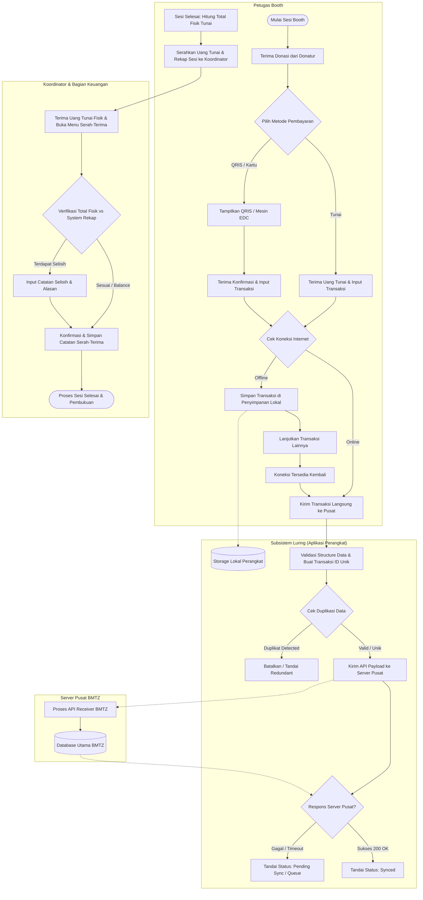

# SOFTWARE REQUIREMENTS SPECIFICATION (SRS)

## Subsistem Penerimaan Donasi Luring — BMTZ

* **ID Dokumen:** BMTZ-SRS-OFFLINE-001
* **Versi:** 0.2 (Revisi Pemenuhan Kebutuhan Dosen)
* **Status:** Draft — Untuk Validasi Stakeholder
* **Tanggal:** 4 November 2026
* **Organisasi:** Baitulmal Tazkia
* **Kelompok:** Kelompok 6
* **Bahasa:** Indonesia
* **Standar Acuan:** ISO/IEC/IEEE 29148:2018
* **Acuan Kualitas Tambahan:** ISO/IEC 25010:2023

---

### Kontrol Dokumen

| Versi | Tanggal | Deskripsi Perubahan | Status |
| :--- | :--- | :--- | :--- |
| 0.1 | 21 Oktober 2026 | Penyusunan awal SRS berdasarkan workbook proyek dan informasi yang tersedia. | Draft |
| 0.2 | 4 November 2026 | Penambahan Format Outline, Detail Proses Bisnis (As-Is & To-Be), Spesifikasi Field/Tipe Data/Validasi (Kamus Data), UI Mockup (Wireframe), dan metrik terukur pada NFR. | Draft |

### Persetujuan Dokumen

| Peran | Nama | Status Persetujuan |
| :--- | :--- | :--- |
| Perwakilan stakeholder BMTZ | Belum ditentukan | Belum disetujui |
| Koordinator proyek | Belum ditentukan | Belum disetujui |
| Perwakilan tim pengembang | Belum ditentukan | Belum disetujui |
| Perwakilan penguji | Belum ditentukan | Belum disetujui |

> **Catatan:** Dokumen ini merupakan spesifikasi awal untuk proses elisitasi, analisis, dan validasi kebutuhan. Kebutuhan berstatus kandidat belum boleh dianggap sebagai keputusan final sebelum memperoleh konfirmasi dari stakeholder yang berwenang.

---

## DAFTAR ISI (FORMAT OUTLINE)

* **Kontrol Dokumen & Persetujuan Dokumen**
* **Daftar Isi (Format Outline)**
* **1. Pendahuluan**
  * 1.1 Tujuan Dokumen
  * 1.2 Ruang Lingkup Produk
  * 1.3 Tujuan Bisnis
  * 1.4 Definisi dan Singkatan
  * 1.5 Referensi
  * 1.6 Ikhtisar Dokumen (Format Outline SRS)
* **2. Deskripsi Umum & Proses Bisnis**
  * 2.1 Perspektif Produk
  * 2.2 Analisis dan Alur Proses Bisnis (As-Is & To-Be)
    * 2.2.1 Proses Bisnis Saat Ini (As-Is) dan Permasalahan
    * 2.2.2 Proses Bisnis Usulan (To-Be) & Tabel Skenario Operasional
    * 2.2.3 Diagram Proses Bisnis (BPMN / Swimlane Diagram)
  * 2.3 Kelas Pengguna dan Pemangku Kepentingan
  * 2.4 Lingkungan Operasional
  * 2.5 Batasan dan Ketergantungan
  * 2.6 Asumsi dan Hal yang Belum Dipastikan
* **3. Kebutuhan Fungsional**
  * 3.1 Pencatatan Donasi (FR-01 s.d. FR-03)
  * 3.2 Operasi Luring & Sinkronisasi (FR-04 s.d. FR-07)
  * 3.3 Serah-Terima Uang Tunai (FR-08 s.d. FR-09)
  * 3.4 Pelaporan dan Pencarian (FR-10 s.d. FR-13)
  * 3.5 Akses dan Pengelolaan Data (FR-14 s.d. FR-16)
* **4. Kebutuhan Antarmuka Eksternal & UI Mockup**
  * 4.1 Kebutuhan Antarmuka Pengguna
  * 4.2 Rancangan Antarmuka Pengguna (UI Mockup / Wireframe)
    * 4.2.1 Mockup 1: Halaman Login & Pembukaan Sesi Booth
    * 4.2.2 Mockup 2: Halaman Utama Pencatatan Donasi (Mode Online/Offline)
    * 4.2.3 Mockup 3: Halaman Antrean Sinkronisasi & Riwayat Transaksi Lokal
    * 4.2.4 Mockup 4: Halaman Penutupan Sesi & Serah-Terima Tunai
  * 4.3 Antarmuka Perangkat Keras
  * 4.4 Antarmuka Perangkat Lunak
  * 4.5 Antarmuka Komunikasi
* **5. Kebutuhan Data (Spesifikasi Field, Tipe Data, dan Validasi)**
  * 5.1 Daftar Entitas Data Awal
  * 5.2 Spesifikasi Detail Field, Tipe Data, dan Aturan Validasi (Kamus Data)
    * 5.2.1 Tabel `transactions` (Transaksi Donasi)
    * 5.2.2 Tabel `booth_sessions` (Sesi Operasional Booth)
    * 5.2.3 Tabel `cash_handovers` (Serah-Terima Uang Tunai)
    * 5.2.4 Tabel `sync_queues` (Antrean Sinkronisasi Lokal)
    * 5.2.5 Tabel `audit_logs` (Catatan Aktivitas / Audit Trail)
  * 5.3 Integritas dan Konsistensi Data
  * 5.4 Privasi dan Retensi
* **6. Kebutuhan Nonfungsional (Non-Functional Requirements)**
  * 6.1 Keamanan (Security)
  * 6.2 Keandalan dan Ketersediaan (Reliability & Availability)
  * 6.3 Kinerja dan Efisiensi (Performance Efficiency)
  * 6.4 Usabilitas dan Kompatibilitas (Usability & Compatibility)
  * 6.5 Kemudahan Pemeliharaan dan Portabilitas (Maintainability & Portability)
* **7. Aturan Bisnis dan Penanganan Pengecualian**
* **8. Kriteria Penerimaan dan Verifikasi**
* **9. Matriks Keterlacakan Awal (RTM)**
* **10. Isu Terbuka dan Validasi**
* **11. Pengelolaan Perubahan Kebutuhan**
* **12. Penutup**

---

## 1. Pendahuluan

### 1.1 Tujuan Dokumen
Dokumen Software Requirements Specification (SRS) ini mendefinisikan kebutuhan awal perangkat lunak untuk Subsistem Penerimaan Donasi Luring Baitulmal Tazkia.

Dokumen ini bertujuan untuk:
1. Mendefinisikan ruang lingkup dan batasan subsistem.
2. Mengidentifikasi kebutuhan fungsional dan nonfungsional.
3. Menetapkan kebutuhan awal terkait pencatatan donasi dalam kondisi koneksi internet tidak stabil.
4. Menjelaskan kebutuhan pengelolaan transaksi, sinkronisasi data, dan pelaporan penerimaan.
5. Menjadi dasar perancangan, implementasi, pengujian, dan validasi bersama stakeholder.
6. Menyediakan keterlacakan antara kebutuhan, sumber, dan metode verifikasi.

### 1.2 Ruang Lingkup Produk
Subsistem Penerimaan Donasi Luring merupakan bagian dari sistem penerimaan donasi Baitulmal Tazkia yang digunakan dalam kegiatan pengumpulan donasi melalui booth di pusat perbelanjaan, masjid, dan lokasi acara.

Subsistem ini direncanakan untuk mendukung pencatatan donasi menggunakan perangkat yang koneksi internetnya tidak selalu tersedia, pengelolaan informasi transaksi, serta pengiriman data ke sistem pusat ketika koneksi tersedia.

Ruang lingkup awal mencakup:
* Pencatatan donasi tunai, QRIS, dan kartu.
* Penyimpanan transaksi ketika koneksi internet tidak tersedia.
* Sinkronisasi transaksi ke sistem pusat ketika koneksi tersedia.
* Penanganan potensi duplikasi transaksi.
* Pencatatan serah-terima uang tunai beserta tahapan yang dapat ditelusuri.
* Penyusunan rekap penerimaan berdasarkan sesi atau acara.
* Dukungan pertukaran data dengan subsistem terkait melalui kontrak API yang disepakati.

*Detail teknis, aturan operasional, dan kewenangan pengguna masih perlu divalidasi.*

### 1.3 Tujuan Bisnis

| ID Tujuan | Tujuan Bisnis |
| :--- | :--- |
| **BG-01** | Mendukung pencatatan penerimaan donasi secara konsisten pada kegiatan booth luring. |
| **BG-02** | Mengurangi risiko kehilangan dan duplikasi data transaksi. |
| **BG-03** | Mendukung sinkronisasi data dari perangkat petugas ke sistem pusat. |
| **BG-04** | Mendukung penelusuran tahapan serah-terima uang tunai. |
| **BG-05** | Menyediakan rekap penerimaan donasi berdasarkan sesi atau acara. |
| **BG-06** | Mendukung pertukaran data dengan subsistem terkait sesuai kontrak antarmuka yang disepakati. |

### 1.4 Definisi dan Singkatan

| Istilah | Definisi |
| :--- | :--- |
| **SRS** | *Software Requirements Specification*, dokumen spesifikasi kebutuhan perangkat lunak. |
| **BMTZ** | Baitulmal Tazkia. |
| **Booth** | Lokasi pengumpulan donasi pada kegiatan atau acara. |
| **Sesi** | Periode operasional booth yang ditetapkan untuk pencatatan penerimaan. |
| **Offline-first** | Pendekatan yang memungkinkan fungsi tertentu tetap berjalan ketika koneksi internet tidak tersedia. |
| **Sinkronisasi** | Proses pertukaran data antara perangkat lokal dan sistem pusat. |
| **API** | *Application Programming Interface*, antarmuka pertukaran data antarsistem. |
| **QRIS** | *Quick Response Code Indonesian Standard*. |
| **EDC** | *Electronic Data Capture*, mesin penerima pembayaran kartu debit/kredit. |
| **UUID** | *Universally Unique Identifier*, standar identitas unik 128-bit untuk mencegah bentrok ID saat offline. |
| **Idempotency** | Properti operasi di mana pengiriman permintaan berkali-kali memberikan hasil yang sama tanpa duplikasi. |
| **Audit trail** | Catatan aktivitas dan perubahan yang dapat digunakan untuk menelusuri suatu kejadian. |
| **Stakeholder** | Pihak yang memiliki kepentingan atau kewenangan terhadap proses maupun sistem. |
| **TBD** | *To Be Determined*, hal yang masih perlu ditentukan. |
| **RTM** | *Requirements Traceability Matrix*, matriks keterlacakan kebutuhan. |

### 1.5 Referensi
1. Workbook Proyek Kelompok 6 — Booth Luring, Baitulmal Tazkia.
2. ISO/IEC/IEEE 29148:2018 — *Systems and software engineering — Life cycle processes — Requirements engineering*.
3. ISO/IEC 25010:2023 — *Systems and software Quality Requirements and Evaluation (SQuaRE) — Product quality model*.
4. Kontrak API antarsubsistem BMTZ — *menunggu dokumen final*.
5. Catatan hasil wawancara dan observasi stakeholder — *belum tersedia pada tahap penyusunan ini*.

### 1.6 Ikhtisar Dokumen (Format Outline SRS)
Dokumen SRS ini disusun mengikuti standar **ISO/IEC/IEEE 29148:2018** yang diorganisasikan ke dalam 12 bagian utama:
* **Bab 1 (Pendahuluan):** Menjelaskan tujuan, ruang lingkup, tujuan bisnis, definisi istilah, referensi, dan struktur outline dokumen.
* **Bab 2 (Deskripsi Umum & Proses Bisnis):** Menguraikan perspektif produk, perbandingan proses bisnis *As-Is* vs *To-Be*, rincian alur kerja operasional, diagram BPMN/Swimlane, profil pengguna, serta batasan dan asumsi.
* **Bab 3 (Kebutuhan Fungsional):** Merinci daftar layanan dan fungsi spesifik (FR-01 hingga FR-16) yang wajib disediakan sistem.
* **Bab 4 (Kebutuhan Antarmuka Eksternal & UI Mockup):** Menjabarkan spesifikasi antarmuka pengguna beserta wireframe/UI mockup layar utama, antarmuka perangkat keras, perangkat lunak, dan protokol komunikasi.
* **Bab 5 (Kebutuhan Data):** Mendefinisikan entitas data, kamus data lengkap (nama field, tipe data, panjang karakter, sifat wajib/opsional, dan aturan validasi), serta kebijakan integritas dan retensi.
* **Bab 6 (Kebutuhan Nonfungsional):** Menetapkan standar kualitas sistem berdasarkan ISO/IEC 25010:2023 dengan target metrik yang terukur.
* **Bab 7 s.d. Bab 12:** Memuat aturan bisnis, skenario pengecualian, skenario pengujian/verifikasi, matriks keterlacakan (RTM), isu terbuka, dan prosedur manajemen perubahan.

---

## 2. Deskripsi Umum & Proses Bisnis

### 2.1 Perspektif Produk
Subsistem Penerimaan Donasi Luring merupakan bagian dari ekosistem sistem BMTZ. Subsistem berinteraksi dengan petugas booth, data donasi, sistem pusat, layanan pembayaran, dan subsistem lain yang membutuhkan data penerimaan donasi.

Gambaran konteks awal:
* **Petugas booth:** mencatat transaksi penerimaan donasi.
* **Sistem penerimaan donasi luring:** mengelola pencatatan lokal, status transaksi, dan sinkronisasi.
* **Sistem pusat BMTZ:** menerima data transaksi yang disinkronkan sesuai kontrak API.
* **Layanan pembayaran:** menyediakan informasi yang relevan untuk pembayaran digital sesuai integrasi yang disepakati.
* **Subsistem rekonsiliasi dan settlement:** menggunakan data transaksi dan setoran yang relevan.
* **Subsistem relawan dan operasional acara:** menyediakan informasi penugasan petugas per sesi sesuai kontrak integrasi.

### 2.2 Analisis dan Alur Proses Bisnis (As-Is & To-Be)

#### 2.2.1 Proses Bisnis Saat Ini (As-Is) dan Permasalahan
Pada kegiatan operasional booth luring di lapangan (seperti di basement masjid, aula pameran, atau pusat perbelanjaan), pencatatan donasi sering menghadapi kendala berikut:
1. **Ketergantungan Koneksi / Pencatatan Manual:** Ketika sinyal internet di lokasi acara buruk, petugas tidak dapat mengakses formulir web pusat sehingga beralih mencatat di kuitansi kertas atau spreadsheet lokal.
2. **Risiko Kehilangan & Duplikasi Data:** Saat memindahkan catatan kertas/spreadsheet ke sistem pusat secara manual setelah acara selesai, sering terjadi salah ketik nominal, kehilangan bukti fisik, atau penginputan ganda (*double input*) akibat koneksi yang *timeout* saat menekan tombol simpan.
3. **Sulitnya Rekonsiliasi Tunai:** Serah-terima uang tunai dari petugas booth ke koordinator lapangan sering kali tidak memiliki bukti rekap sistem yang *real-time*, sehingga selisih uang fisik baru diketahui berhari-hari kemudian oleh bagian keuangan.

#### 2.2.2 Proses Bisnis Usulan (To-Be) & Tabel Skenario Operasional
Subsistem Penerimaan Donasi Luring menerapkan arsitektur **Offline-First** dengan tahapan proses bisnis terstruktur sebagai berikut:

| Kode Proses | Nama Proses Bisnis | Aktor Terlibat | Kondisi Awal (Pre-Condition) | Alur Proses Utama (Normal Flow) | Alur Alternatif / Pengecualian (Exception Flow) | Kondisi Akhir (Post-Condition) |
| :--- | :--- | :--- | :--- | :--- | :--- | :--- |
| **BP-01** | Pembukaan Sesi Booth | Petugas Booth | Petugas telah login dan memiliki penugasan booth aktif. | 1. Petugas memilih lokasi booth dan shift/sesi.<br>2. Petugas memasukkan saldo kas awal (*modal kembalian*).<br>3. Sistem membuka sesi dan mengunci ID Sesi pada perangkat. | Jika perangkat sedang offline saat mulai sesi, sistem menggunakan data penugasan yang telah di-*cache* sebelumnya. | Sesi berstatus `OPEN` dan siap menerima input transaksi. |
| **BP-02** | Pencatatan Donasi (Tunai, QRIS, Kartu) | Petugas Booth, Donatur | Sesi berstatus `OPEN`. | 1. Petugas menginput data donatur (opsional/anonim), jenis akad/program donasi, nominal, dan metode bayar.<br>2. Untuk Tunai: Petugas menerima uang fisik.<br>3. Untuk QRIS/EDC: Petugas menampilkan QRIS/memproses EDC dan menginput nomor referensi pembayaran.<br>4. Sistem memvalidasi input dan membuat `client_transaction_id` (UUID v4).<br>5. Sistem menyimpan transaksi ke database lokal dan langsung mengirim ke Server Pusat jika online. | **Jika Offline / Koneksi Lambat:**<br>Sistem menyimpan transaksi ke *Local Storage* (IndexedDB) dengan status `PENDING_SYNC` dalam waktu $< 1$ detik tanpa menghambat antrean donatur. | Transaksi tercatat dengan aman (status `SYNCED` atau `PENDING_SYNC`). |
| **BP-03** | Sinkronisasi Otomatis & Deduplikasi | Subsistem Luring, Server Pusat BMTZ | Terdapat transaksi berstatus `PENDING_SYNC` atau `FAILED_SYNC` di perangkat. | 1. Sistem mendeteksi koneksi internet kembali stabil.<br>2. *Background worker* mengambil antrean transaksi lokal secara berurutan (FIFO).<br>3. Sistem mengirim payload ke API Pusat dengan menyertakan `idempotency_key` (`client_transaction_id`).<br>4. Server Pusat memeriksa keunikan ID, menyimpan data, dan mengembalikan HTTP 200/201.<br>5. Aplikasi mengubah status lokal menjadi `SYNCED`. | **Jika Duplikat Terdeteksi:** Server Pusat mengenali `idempotency_key` yang sudah ada, tidak membuat record baru, dan mengembalikan respons sukses agar aplikasi lokal menandai `SYNCED`.<br>**Jika Timeout/5xx:** Sistem melakukan *retry* otomatis dengan *exponential backoff*. | Seluruh transaksi lokal tersinkronisasi dengan database pusat tanpa duplikasi. |
| **BP-04** | Penutupan Sesi & Serah-Terima Tunai | Petugas Booth, Koordinator, Bagian Keuangan | Periode sesi berakhir. | 1. Petugas menekan tombol "Tutup Sesi" dan sistem mengalkulasi total penerimaan (Tunai vs Non-Tunai).<br>2. Petugas menghitung uang fisik tunai dan memasukkan nominal fisik ke sistem.<br>3. Koordinator memeriksa kesesuaian uang fisik dengan rekap sistem.<br>4. Koordinator melakukan konfirmasi terima uang pada sistem (otorisasi PIN/Tanda Tangan Digital). | **Jika Terdapat Selisih:** Sistem mewajibkan pengisian kolom `discrepancy_note` (alasan selisih kurang/lebih) sebelum serah-terima dapat disahkan.<br>**Jika Masih Ada `PENDING_SYNC`:** Sistem memberi peringatan dan menandai penutupan sebagai `PROVISIONAL_CLOSE` hingga sinkronisasi tuntas. | Sesi berstatus `CLOSED` dan berita acara serah-terima tunai tercatat dalam *audit trail*. |

#### 2.2.3 Diagram Proses Bisnis (BPMN / Swimlane Diagram)
Berikut merupakan alur proses bisnis operasional pencatatan donasi luring, sinkronisasi data, dan serah-terima uang tunai dalam bentuk diagram Mermaid:



### 2.3 Kelas Pengguna dan Pemangku Kepentingan

| Pengguna / Pihak | Tanggung Jawab atau Kepentingan Awal | Hak Akses Utama | Status |
| :--- | :--- | :--- | :--- |
| **Petugas booth** | Mencatat penerimaan donasi pada kegiatan booth, membuka/menutup sesi, dan menyerahkan uang tunai. | Input transaksi, lihat rekap sesi sendiri, picu sinkronisasi manual, buat draf serah-terima. | Kandidat; perlu validasi |
| **Koordinator** | Memverifikasi dan menerima serah-terima uang tunai dari petugas di lapangan serta mengesahkan koreksi. | Verifikasi & *approve* serah-terima tunai, otorisasi pembatalan/koreksi transaksi, lihat rekap seluruh booth acara. | Kandidat; perlu validasi |
| **Bagian keuangan** | Melakukan rekonsiliasi data setoran tunai maupun settlement non-tunai (QRIS/EDC). | Lihat seluruh laporan sesi, audit trail serah-terima, dan ekspor data rekonsiliasi. | Kandidat; perlu validasi |
| **Administrator sistem** | Mengelola master data booth, sesi acara, konfigurasi API, dan manajemen akun. | Konfigurasi sistem dan manajemen peran pengguna (*Role-Based Access Control*). | Peran dan kewenangan belum ditentukan |
| **Pengelola operasional BMTZ** | Memvalidasi prosedur dan aturan bisnis. | Pemilik proses bisnis (*Business Owner*). | Nama narasumber belum ditentukan |
| **Tim pengembang & penguji** | Mengimplementasikan dan memverifikasi pemenuhan kebutuhan sistem. | Lingkungan *development* dan *staging*. | Tim proyek |

### 2.4 Lingkungan Operasional
* Kegiatan berlangsung pada booth di mal, masjid, dan lokasi acara dengan mobilitas tinggi.
* Perangkat petugas berupa *smartphone*, tablet, atau laptop yang menjalankan peramban web modern (*Progressive Web App* / PWA) dan sering mengalami keterbatasan/ketiadaan sinyal seluler maupun Wi-Fi.
* Pencatatan transaksi wajib tetap berjalan normal ketika koneksi internet terputus (*offline-first*).
* Data yang tersimpan lokal dikirimkan ke sistem pusat secara otomatis maupun manual ketika koneksi kembali tersedia.

### 2.5 Batasan dan Ketergantungan
1. Subsistem merupakan bagian dari proyek BMTZ dan harus mengikuti batas integrasi antarsubsistem.
2. Pertukaran data antarsubsistem dilakukan melalui kontrak API berformat JSON melalui protokol HTTPS yang disepakati.
3. Struktur database internal tidak boleh mengasumsikan hubungan *foreign key* langsung melintasi batas database subsistem lain.
4. Integrasi pembayaran QRIS bergantung pada kontrak dan ketersediaan layanan pembayaran (*Payment Gateway*) yang digunakan proyek.
5. Struktur identitas donatur dan data transaksi harus mengikuti kontrak dengan subsistem CRM/Donatur dan Rekonsiliasi.

### 2.6 Asumsi dan Hal yang Belum Dipastikan

| ID | Pernyataan | Status |
| :--- | :--- | :--- |
| **ASM-01** | Pencatatan transaksi perlu tetap tersedia ketika koneksi internet tidak tersedia. | Berdasarkan ruang lingkup workbook |
| **ASM-02** | Data transaksi perlu disinkronkan ke sistem pusat ketika koneksi tersedia. | Berdasarkan ruang lingkup workbook |
| **ASM-03** | Sistem memerlukan mekanisme untuk mengidentifikasi potensi transaksi duplikat. | Berdasarkan risiko pada workbook |
| **ASM-04** | Setiap tahapan serah-terima uang tunai harus dapat ditelusuri. | Berdasarkan ruang lingkup workbook |
| **ASM-05** | Donatur boleh memilih untuk berdonasi secara anonim (Hamba Allah) tanpa wajib memberikan nomor telepon atau email. | Belum dikonfirmasi; perlu validasi |
| **ASM-06** | Semua jenis pembayaran digital dapat diverifikasi secara otomatis atau melalui input referensi manual saat offline. | Belum dikonfirmasi |
| **ASM-07** | Transaksi yang telah dicatat hanya boleh dibatalkan/dikoreksi dengan otorisasi Koordinator dan meninggalkan jejak audit. | Belum dikonfirmasi |

---

## 3. Kebutuhan Fungsional

### 3.1 Pencatatan Donasi

#### FR-01 — Pencatatan Transaksi Donasi
Sistem harus menyediakan fungsi untuk mencatat transaksi penerimaan donasi pada booth dan sesi yang teridentifikasi.
* **Kriteria verifikasi awal:**
  * Transaksi dapat dimasukkan melalui antarmuka pencatatan.
  * Transaksi yang memenuhi aturan validasi dapat disimpan.
  * Transaksi yang tidak memenuhi aturan validasi ditolak disertai pesan kesalahan pada field terkait.
* **Status:** Kandidat.

#### FR-02 — Informasi Transaksi
Sistem harus menyimpan informasi transaksi yang diperlukan untuk identifikasi, penelusuran, dan pelaporan.
* **Informasi kandidat meliputi:** Identitas unik transaksi (`client_transaction_id`), identitas booth dan sesi, tanggal dan waktu pencatatan perangkat, kategori program donasi, nama/kontak donatur (opsional), nominal donasi, metode pembayaran, status transaksi, dan status sinkronisasi.
* **Status:** Kandidat; skema data perlu divalidasi.

#### FR-03 — Metode Pembayaran
Sistem harus mendukung pencatatan metode pembayaran tunai (`CASH`), QRIS (`QRIS`), dan kartu debit/kredit (`CARD`) sesuai ruang lingkup proyek. Sistem harus membedakan pencatatan transaksi dari konfirmasi keberhasilan pembayaran apabila konfirmasi pembayaran tersedia melalui layanan terkait.
* **Kriteria verifikasi awal:**
  * Metode pembayaran yang diizinkan dapat dipilih.
  * Metode yang tidak valid ditolak.
  * Untuk pembayaran `QRIS` dan `CARD` dalam kondisi luring, sistem menyediakan kolom nomor referensi/approval code atau unggah foto bukti bayar.
* **Status:** Kandidat; aturan konfirmasi pembayaran perlu divalidasi.

### 3.2 Operasi Luring & Sinkronisasi

#### FR-04 — Penyimpanan Lokal
Sistem harus memungkinkan transaksi disimpan pada penyimpanan lokal perangkat (IndexedDB / Local Database) ketika koneksi internet tidak tersedia.
* **Kriteria verifikasi awal:**
  * Transaksi yang memenuhi validasi dapat disimpan saat perangkat offline.
  * Pengguna memperoleh umpan balik visual bahwa transaksi tersimpan secara lokal.
  * Data yang belum dikirim ke sistem pusat dapat dibedakan dari data yang telah tersinkron.
* **Status:** Kandidat.

#### FR-05 — Status Sinkronisasi
Sistem harus menyediakan indikator status yang membedakan transaksi yang belum disinkronkan (`PENDING_SYNC`), sedang diproses (`SYNCING`), berhasil disinkronkan (`SYNCED`), atau mengalami kegagalan (`FAILED_SYNC`).
* **Kriteria verifikasi awal:** Status sesuai dengan hasil proses sinkronisasi, kegagalan sinkronisasi tidak ditampilkan sebagai keberhasilan, serta pengguna dapat melihat daftar transaksi yang memerlukan penanganan lebih lanjut.
* **Status:** Kandidat.

#### FR-06 — Sinkronisasi Transaksi
Sistem harus mengirimkan transaksi lokal yang berada dalam antrean ke sistem pusat secara otomatis ketika koneksi tersedia kembali, serta menyediakan tombol pemicu sinkronisasi manual ("Sinkronkan Sekarang").
* **Kriteria verifikasi awal:**
  * Transaksi berstatus `PENDING_SYNC` masuk ke antrean pengiriman saat online.
  * Respons sistem pusat dicatat beserta `synced_at` sesuai kontrak API.
  * Transaksi yang gagal dikirim tetap tersimpan di lokal untuk percobaan pengiriman berikutnya.
* **Status:** Kandidat.

#### FR-07 — Penanganan Transaksi Duplikat
Sistem harus mendukung identifikasi dan pencegahan duplikasi transaksi selama pencatatan atau pengiriman ulang sinkronisasi menggunakan mekanisme `idempotency_key` berbasis UUID.
* **Kriteria verifikasi awal:**
  * Pengiriman ulang transaksi yang sama akibat koneksi terputus di tengah jalan dapat dikenali oleh server berdasarkan `client_transaction_id`.
  * Sistem tidak menghasilkan transaksi ganda di server pusat akibat pengiriman ulang payload yang sama.
  * Peringatan muncul di layar petugas apabila mendeteksi input dengan nominal, metode bayar, dan nama donatur yang sama persis dalam rentang waktu $< 60$ detik.
* **Status:** Kandidat.

### 3.3 Serah-Terima Uang Tunai

#### FR-08 — Pencatatan Serah-Terima
Sistem harus mendukung pencatatan serah-terima uang tunai dari petugas booth kepada koordinator dan tahapan selanjutnya sesuai prosedur BMTZ.
* **Informasi kandidat meliputi:** Referensi sesi atau acara, pihak yang menyerahkan, pihak yang menerima, nominal tunai menurut sistem, nominal uang tunai fisik yang dihitung, selisih (*discrepancy*), waktu serah-terima, status konfirmasi, dan catatan selisih jika ditemukan.
* **Status:** Kandidat.

#### FR-09 — Penelusuran Tahapan Serah-Terima
Sistem harus menyediakan riwayat berurutan (*audit trail*) yang dapat digunakan untuk menelusuri tahapan perpindahan uang tunai dari Petugas Booth $\rightarrow$ Koordinator Lapangan $\rightarrow$ Bagian Keuangan.
* **Status:** Kandidat.

### 3.4 Pelaporan dan Pencarian

#### FR-10 — Rekap Penerimaan
Sistem harus menyediakan rekap penerimaan donasi secara *real-time* pada perangkat berdasarkan sesi booth atau rentang waktu yang dipilih.
* **Status:** Kandidat.

#### FR-11 — Rincian Metode Pembayaran
Sistem harus menyajikan rincian total dan jumlah transaksi penerimaan yang dipisahkan berdasarkan metode pembayaran (`CASH`, `QRIS`, `CARD`) serta memisahkan mana yang sudah `SYNCED` dan `PENDING_SYNC`.
* **Status:** Kandidat.

#### FR-12 — Pencarian Transaksi
Sistem harus menyediakan fungsi pencarian dan penyaringan (*filter*) transaksi berdasarkan ID transaksi, nama donatur, metode pembayaran, atau status sinkronisasi.
* **Status:** Kandidat.

#### FR-13 — Penutupan Sesi atau Acara
Sistem harus mendukung penyusunan rekap penutupan penerimaan per sesi atau acara. Aturan penutupan harus memberi peringatan jika masih terdapat transaksi yang belum tersinkron (`PENDING_SYNC`).
* **Status:** Kandidat.

### 3.5 Akses dan Pengelolaan Data

#### FR-14 — Pengendalian Akses
Sistem harus membatasi akses terhadap fungsi dan data sesuai peran pengguna (*Petugas Booth*, *Koordinator*, *Keuangan*, *Admin*) menggunakan autentikasi token.
* **Status:** Kandidat.

#### FR-15 — Koreksi dan Pembatalan Transaksi
Apabila koreksi atau pembatalan transaksi (*void*) dilakukan, sistem wajib menerapkan mekanisme *soft-delete*/pembatalan berotorisasi tanpa menghapus baris data asli, mewajibkan pengisian alasan pembatalan, serta mencatatnya ke dalam *audit trail*.
* **Status:** Kandidat.

#### FR-16 — Pertukaran Data dengan Sistem Terkait
Sistem harus menyediakan pertukaran data melalui kontrak RESTful API yang disepakati dengan sistem pusat dan subsistem terkait.
* **Status:** Kandidat.

---

## 4. Kebutuhan Antarmuka Eksternal & UI Mockup

### 4.1 Kebutuhan Antarmuka Pengguna

| ID | Kebutuhan Antarmuka Pengguna |
| :--- | :--- |
| **UI-01** | Antarmuka pencatatan harus menampilkan label, format mata uang Rupiah (Rp), dan informasi input yang jelas. |
| **UI-02** | Sistem harus memberikan umpan balik visual langsung (*inline error message*) terhadap input yang tidak valid. |
| **UI-03** | Status koneksi perangkat (`ONLINE` / `OFFLINE`) dan jumlah antrean sinkronisasi harus selalu tampil pada *header* aplikasi. |
| **UI-04** | Pesan kegagalan harus membantu pengguna memahami tindakan berikutnya dalam bahasa Indonesia yang jelas tanpa menampilkan *stack trace* atau informasi teknis sensitif. |
| **UI-05** | Antarmuka web harus bersifat *responsive* (*mobile-first*) agar nyaman dioperasikan dengan satu atau dua tangan pada tablet/smartphone di booth lapangan. |
| **UI-06** | Validasi input harus diterapkan baik pada sisi klien (*client-side*) saat offline maupun diverifikasi ulang pada sisi server (*server-side*) saat sinkronisasi. |

### 4.2 Rancangan Antarmuka Pengguna (UI Mockup / Wireframe)

Berikut adalah rancangan *low-fidelity wireframe* (UI Mockup) untuk 4 layar utama Subsistem Penerimaan Donasi Luring BMTZ:

#### 4.2.1 Mockup 1: Halaman Login & Pembukaan Sesi Booth
Digunakan oleh Petugas Booth saat memulai tugas pada sesi/shift acara.

```text
+-------------------------------------------------------------------+
|  BMTZ - PENERIMAAN DONASI LURING              [Status: ● ONLINE]  |
+-------------------------------------------------------------------+
|                                                                   |
|                 PEMBUKAAN SESI OPERASIONAL BOOTH                  |
|                 --------------------------------                  |
|  Petugas Login : Ahmad Fauzi (ID: PTG-2026-089)                   |
|  Peran         : Petugas Booth                                    |
|                                                                   |
|  1. Pilih Lokasi Acara / Booth (*)                                |
|     [ Dropdown: Booth Masjid Istiqlal - Zona Utama            v ] |
|                                                                   |
|  2. Pilih Sesi / Shift Operasional (*)                            |
|     [ Dropdown: Sesi Pagi (08:00 - 12:00 WIB) - 04 Nov 2026   v ] |
|                                                                   |
|  3. Saldo Kas Awal / Uang Kembalian (Rp) (*)                      |
|     [ Rp 200.000                                                ] |
|                                                                   |
|  4. Catatan Pembukaan Sesi (Opsional)                             |
|     [ Kondisi perangkat baik, mesin EDC Mandiri siap.           ] |
|                                                                   |
|  +-------------------------------------------------------------+  |
|  |                  [ MULAI SESI BOOTH SEKARANG ]              |  |
|  +-------------------------------------------------------------+  |
+-------------------------------------------------------------------+
```

#### 4.2.2 Mockup 2: Halaman Utama Pencatatan Donasi (Mode Online / Offline)
Layar kerja utama petugas untuk mencatat transaksi secara cepat di lapangan.

```text
+-------------------------------------------------------------------+
|  BMTZ BOOTH: Masjid Istiqlal (Sesi Pagi)      [Status: ▲ OFFLINE] |
|  Antrean Lokal Belum Sinkron: 3 Transaksi     [ Sinkronkan (3) ]  |
+-------------------------------------------------------------------+
|  [ + INPUT DONASI ]   [ RIWAYAT & SINKRON (18) ]   [ TUTUP SESI ] |
+-------------------------------------------------------------------+
|                                                                   |
|  INFORMASI DONATUR                                                |
|  [x] Donatur Anonim (Hamba Allah)                                 |
|  Nama Donatur     : [ Hamba Allah                               ] |
|  No. WhatsApp/HP  : [ 0812xxxxxxxx (Opsional untuk bukti WA)    ] |
|                                                                   |
|  RINCIAN PENERIMAAN DONASI                                        |
|  Kategori Program (*) :                                           |
|  (•) Zakat Maal   ( ) Infaq/Sedekah   ( ) Wakaf   ( ) Kemanusiaan |
|                                                                   |
|  Nominal Donasi (Rp) (*) :                                        |
|  +-------------------------------------------------------------+  |
|  | Rp  500.000                                                 |  |
|  +-------------------------------------------------------------+  |
|  Nominal Cepat: [Rp 50.000] [Rp 100.000] [Rp 250.000] [Rp 500.000]|
|                                                                   |
|  Metode Pembayaran (*) :                                          |
|  +-------------------+ +-------------------+ +-----------------+  |
|  | [•] TUNAI (CASH)  | | [ ] QRIS STATIS   | | [ ] KARTU / EDC |  |
|  +-------------------+ +-------------------+ +-----------------+  |
|                                                                   |
|  No. Referensi / Approval Code (Wajib jika QRIS/EDC) :            |
|  [ -                                                           ]  |
|                                                                   |
|  Catatan Tambahan (Doa / Pengkhususan) :                          |
|  [ Semoga berkah untuk keluarga                                ]  |
|                                                                   |
|  +-------------------------------------------------------------+  |
|  |          [ SIMPAN TRANSAKSI (TERSIMPAN DI LOKAL) ]          |  |
|  +-------------------------------------------------------------+  |
|  *Info: Perangkat sedang OFFLINE. Transaksi akan disimpan aman    |
|   di penyimpanan perangkat dan dikirim otomatis saat online.      |
+-------------------------------------------------------------------+
```

#### 4.2.3 Mockup 3: Halaman Antrean Sinkronisasi & Riwayat Transaksi Lokal
Menampilkan transparansi status setiap transaksi (`SYNCED`, `PENDING_SYNC`, `FAILED_SYNC`) sesuai kebutuhan **FR-05**, **FR-06**, dan **FR-12**.

```text
+-------------------------------------------------------------------+
|  BMTZ BOOTH: Masjid Istiqlal (Sesi Pagi)      [Status: ● ONLINE]  |
|  Antrean Lokal Belum Sinkron: 2 Transaksi     [ ↻ Sinkronkan ]    |
+-------------------------------------------------------------------+
|  [ + INPUT DONASI ]   [ RIWAYAT & SINKRON (18) ]   [ TUTUP SESI ] |
+-------------------------------------------------------------------+
|  Cari: [ Ketik ID / Nama Donatur... ]  Filter: [ Semua Status v ] |
|                                                                   |
|  RINGKASAN SESI INI:                                              |
|  • Total Penerimaan : Rp 4.250.000 (18 Transaksi)                 |
|  • Tunai (Cash)     : Rp 2.500.000 | QRIS: Rp 1.250.000           |
|  • Kartu (EDC)      : Rp   500.000                                |
|  ---------------------------------------------------------------  |
|  DAFTAR TRANSAKSI:                                                |
|                                                                   |
|  1. #TRX-9F8A-018 | 10:12 WIB | Hamba Allah                       |
|     Program : Zakat Maal      | Metode : TUNAI                    |
|     Nominal : Rp 500.000      | Status : [ ⏳ PENDING_SYNC ]      |
|                                                                   |
|  2. #TRX-7C2B-017 | 10:05 WIB | Bpk. Hendra (081234567890)        |
|     Program : Infaq/Sedekah   | Metode : QRIS (Ref: 99281102)     |
|     Nominal : Rp 250.000      | Status : [ ⚠️ FAILED_SYNC ]       |
|     Info    : Timeout koneksi server.    [ Coba Kirim Ulang ]     |
|                                                                   |
|  3. #TRX-3A1D-016 | 09:50 WIB | Ibu Siti Aminah                   |
|     Program : Wakaf Tunai     | Metode : KARTU (Ref: EDC-4412)    |
|     Nominal : Rp 500.000      | Status : [ ✅ SYNCED - 09:51 WIB ]|
|                                                  [ Ajukan Koreksi]|
+-------------------------------------------------------------------+
```

#### 4.2.4 Mockup 4: Halaman Penutupan Sesi & Serah-Terima Tunai
Digunakan bersama oleh Petugas Booth dan Koordinator Lapangan saat sesi berakhir (**FR-08**, **FR-09**, **FR-13**).

```text
+-------------------------------------------------------------------+
|  BMTZ BOOTH: Masjid Istiqlal (Sesi Pagi)      [Status: ● ONLINE]  |
|  Semua Transaksi Telah Tersinkron (0 Pending)                     |
+-------------------------------------------------------------------+
|  [ + INPUT DONASI ]   [ RIWAYAT & SINKRON (18) ]   [ TUTUP SESI ] |
+-------------------------------------------------------------------+
|              FORMULIR PENUTUPAN SESI & SERAH-TERIMA TUNAI         |
|  ---------------------------------------------------------------  |
|  REKAPITULASI SISTEM (OTOMATIS):                                  |
|  • Saldo Kas Awal (Modal)       : Rp   200.000                    |
|  • Total Donasi Tunai (10 Trx)  : Rp 2.500.000                    |
|  • Total Donasi Non-Tunai (8)   : Rp 1.750.000 (QRIS & EDC)       |
|  ---------------------------------------------------------------  |
|  TOTAL UANG TUNAI WAJIB SETOR   : Rp 2.700.000 (Modal + Tunai)    |
|                                                                   |
|  PERHITUNGAN FISIK UANG TUNAI:                                    |
|  Nominal Tunai Fisik Dihitung (*): [ Rp 2.650.000               ] |
|  Selisih (Fisik - Sistem)        : [ - Rp 50.000 (KURANG)       ] |
|                                                                   |
|  Catatan / Alasan Selisih (Wajib diisi karena ada selisih) (*) :  |
|  [ Terselip uang kembalian Rp 50.000 saat antrean ramai pukul 10 ]|
|                                                                   |
|  OTORISASI SERAH-TERIMA:                                          |
|  Diserahkan Oleh (Petugas)    : Ahmad Fauzi (PTG-2026-089) [Sudah]|
|  Diterima Oleh (Koordinator)* : [ Dropdown: Budi Santoso (KOR-02)]|
|  PIN Otorisasi Koordinator *  : [ * * * * * *                   ] |
|                                                                   |
|  +-------------------------------------------------------------+  |
|  |      [ KONFIRMASI SERAH-TERIMA & TUTUP SESI BOOTH ]         |  |
|  +-------------------------------------------------------------+  |
+-------------------------------------------------------------------+
```

### 4.3 Antarmuka Perangkat Keras
Sistem berupa aplikasi berbasis web (*Progressive Web App*) yang berjalan pada perangkat bergerak (smartphone/tablet Android atau iOS) maupun laptop petugas tanpa ketergantungan pada perangkat keras khusus. Pencetakan struk fisik bersifat opsional (menggunakan printer thermal Bluetooth jika tersedia di masa mendatang), dan bukti transaksi utama dapat dikirimkan secara elektronik atau dilihat di layar.

### 4.4 Antarmuka Perangkat Lunak

| ID | Sistem / Layanan | Kebutuhan Antarmuka |
| :--- | :--- | :--- |
| **IF-01** | Sistem pusat BMTZ | Pertukaran data transaksi, pembukaan/penutupan sesi, dan identitas donatur melalui REST API (JSON/HTTPS). |
| **IF-02** | Layanan pembayaran QRIS | Pertukaran informasi *callback* pembayaran dinamis atau pencatatan referensi QRIS statis sesuai integrasi yang berlaku. |
| **IF-03** | Subsistem Rekonsiliasi & Settlement | Penyediaan data transaksi yang telah `SYNCED` dan berita acara setoran tunai (`cash_handovers`). |
| **IF-04** | Subsistem Relawan & Operasional Acara | Pengambilan daftar penugasan petugas per booth dan sesi acara melalui API. |
| **IF-05** | Penyimpanan Lokal Peramban (IndexedDB) | Penyimpanan transaksi saat offline dan manajemen antrean sinkronisasi (*Sync Queue*) pada sisi perangkat klien. |

### 4.5 Antarmuka Komunikasi
* **Protokol Komunikasi:** HTTPS (TLS 1.2 / TLS 1.3) untuk seluruh pertukaran data dengan server pusat.
* **Format Pertukaran Data:** JSON (*JavaScript Object Notation*) dengan pengodean karakter UTF-8.
* **Mekanisme Autentikasi API:** *Bearer Token* berbasis JWT (*JSON Web Token*) serta penyertaan header `X-Idempotency-Key` pada endpoint pengiriman transaksi untuk mencegah duplikasi saat retry.

---

## 5. Kebutuhan Data (Spesifikasi Field, Tipe Data, dan Validasi)

### 5.1 Daftar Entitas Data Awal

| Entitas | Deskripsi | Tabel / Object Store Terkait |
| :--- | :--- | :--- |
| **Transaksi Donasi** | Catatan setiap penerimaan donasi dari donatur di booth. | `transactions` |
| **Booth & Sesi Acara** | Periode operasional booth tempat petugas bertugas. | `booth_sessions` |
| **Serah-Terima Tunai** | Catatan perpindahan fisik uang tunai dari petugas ke koordinator/keuangan. | `cash_handovers` |
| **Antrean Sinkronisasi** | Catatan status pengiriman data dari penyimpanan lokal ke server pusat. | `sync_queues` |
| **Catatan Aktivitas** | Catatan jejak audit (*audit log*) untuk setiap tindakan sensitif/perubahan data. | `audit_logs` |

### 5.2 Spesifikasi Detail Field, Tipe Data, dan Aturan Validasi (Kamus Data)

Berikut adalah spesifikasi detail atribut (*field*), tipe data, sifat wajib (*mandatory/optional*), dan aturan validasi (*validation rules*) yang harus diterapkan di sisi klien maupun server:

#### 5.2.1 Tabel `transactions` (Transaksi Donasi)

| Nama Field | Tipe Data | Wajib? | Aturan Validasi (Validation Rules) | Deskripsi |
| :--- | :--- | :--- | :--- | :--- |
| `client_transaction_id` | `UUID (CHAR(36))` | Wajib (PK) | Format standar UUID v4 (`^[0-9a-f]{8}-[0-9a-f]{4}-4[0-9a-f]{3}-[89ab][0-9a-f]{3}-[0-9a-f]{12}$`), unik secara global. | ID unik yang dibuat di perangkat saat transaksi dicatat; berfungsi sebagai *Idempotency Key*. |
| `server_transaction_id` | `VARCHAR(50)` | Opsional | Unik di server pusat; bernilai `NULL` selama status masih `PENDING_SYNC`. | Nomor kuitansi/ID resmi dari Server Pusat BMTZ setelah sinkronisasi berhasil. |
| `session_id` | `UUID (CHAR(36))` | Wajib (FK) | Harus merujuk pada `session_id` yang valid dan berstatus `OPEN` saat transaksi dibuat. | Identitas sesi operasional booth tempat transaksi dicatat. |
| `booth_id` | `VARCHAR(30)` | Wajib | Tidak boleh kosong; sesuai daftar master booth aktif. | Identitas lokasi booth pengumpulan donasi. |
| `officer_id` | `VARCHAR(30)` | Wajib | Harus sesuai dengan ID petugas yang sedang terautentikasi pada sesi tersebut. | Identitas petugas pencatat transaksi. |
| `donor_name` | `VARCHAR(100)` | Wajib | Panjang 2–100 karakter; hanya huruf, spasi, titik, koma, dan apostrof. Jika `is_anonymous = true`, otomatis diisi `"Hamba Allah"`. | Nama lengkap donatur atau sebutan anonim. |
| `is_anonymous` | `BOOLEAN` | Wajib | Nilai boolean (`true` atau `false`), nilai bawaan (*default*): `false`. | Penanda apakah donatur memilih tidak menyebutkan nama. |
| `donor_phone` | `VARCHAR(20)` | Opsional | Jika diisi, wajib format nomor telepon valid (`^(\+62\|62\|0)8[1-9][0-9]{6,11}$`). | Nomor telepon/WhatsApp donatur untuk pengiriman bukti donasi. |
| `donor_email` | `VARCHAR(100)` | Opsional | Jika diisi, wajib memenuhi format standar email (RFC 5322). | Alamat email donatur. |
| `donation_category` | `ENUM` | Wajib | Nilai harus salah satu dari: `ZAKAT_MAAL`, `ZAKAT_FITRAH`, `INFAQ_SEDEKAH`, `WAKAF`, `KEMANUSIAAN`. | Jenis akad atau program peruntukan donasi. |
| `amount` | `DECIMAL(15,2)` / `BIGINT` | Wajib | Bilangan bulat positif, tanpa desimal sen, nilai minimum $\ge 1000$ (Rp1.000) dan maksimum $\le 1000000000$ (Rp1 Miliar). | Nominal uang donasi dalam mata uang Rupiah (IDR). |
| `payment_method` | `ENUM` | Wajib | Nilai harus salah satu dari: `CASH`, `QRIS`, `CARD`. | Metode pembayaran yang digunakan donatur. |
| `payment_ref_no` | `VARCHAR(100)` | Kondisional | **Wajib diisi** jika `payment_method` adalah `QRIS` atau `CARD` (panjang 4–100 karakter alfanumerik). Opsional jika `CASH`. | Nomor referensi transaksi QRIS (RRN) atau *Approval Code* struk mesin EDC. |
| `payment_status` | `ENUM` | Wajib | Nilai harus salah satu dari: `PAID`, `UNCONFIRMED`, `VOIDED`. | Status keberhasilan pembayaran transaksi. |
| `sync_status` | `ENUM` | Wajib | Nilai harus salah satu dari: `PENDING_SYNC`, `SYNCING`, `SYNCED`, `FAILED_SYNC`, `CONFLICT`. Default saat offline: `PENDING_SYNC`. | Status sinkronisasi data transaksi ke server pusat. |
| `notes` | `VARCHAR(255)` | Opsional | Maksimal 255 karakter teks biasa; disanitasi dari tag HTML/script (pencegahan XSS). | Catatan doa atau keterangan tambahan dari donatur. |
| `recorded_at_client` | `TIMESTAMP (ISO 8601)` | Wajib | Format ISO 8601 dengan zona waktu (`YYYY-MM-DDTHH:mm:ss+07:00`); tidak boleh lebih besar dari waktu masa depan (*future timestamp check*). | Waktu ketika transaksi disimpan pada perangkat petugas. |
| `synced_at_server` | `TIMESTAMP (ISO 8601)` | Opsional | Format ISO 8601; diisi oleh server pusat saat transaksi berhasil diterima. | Waktu ketika transaksi berhasil masuk ke database pusat. |

#### 5.2.2 Tabel `booth_sessions` (Sesi Operasional Booth)

| Nama Field | Tipe Data | Wajib? | Aturan Validasi (Validation Rules) | Deskripsi |
| :--- | :--- | :--- | :--- | :--- |
| `session_id` | `UUID (CHAR(36))` | Wajib (PK) | Format standar UUID v4, unik. | ID unik sesi operasional booth. |
| `booth_id` | `VARCHAR(30)` | Wajib (FK) | Harus terdaftar dalam master lokasi booth BMTZ. | ID lokasi booth. |
| `event_id` | `VARCHAR(30)` | Wajib | Harus merujuk pada kode kegiatan/acara yang aktif. | ID acara/event induk. |
| `officer_id` | `VARCHAR(30)` | Wajib | ID pengguna aktif dengan peran `PETUGAS_BOOTH`. | Petugas penanggung jawab sesi. |
| `opening_cash` | `DECIMAL(15,2)` | Wajib | Angka numerik $\ge 0$ (boleh Rp0 jika tidak membawa uang kembalian). | Saldo uang tunai awal (modal kembalian) saat membuka sesi. |
| `opened_at` | `TIMESTAMP` | Wajib | Format ISO 8601 yang valid. | Waktu pembukaan sesi booth. |
| `closed_at` | `TIMESTAMP` | Opsional | Jika diisi, waktu `closed_at` harus $\ge$ `opened_at`. | Waktu penutupan sesi booth. |
| `session_status` | `ENUM` | Wajib | Nilai harus salah satu dari: `OPEN`, `PROVISIONAL_CLOSE`, `CLOSED`. | Status operasional sesi saat ini. |

#### 5.2.3 Tabel `cash_handovers` (Serah-Terima Uang Tunai)

| Nama Field | Tipe Data | Wajib? | Aturan Validasi (Validation Rules) | Deskripsi |
| :--- | :--- | :--- | :--- | :--- |
| `handover_id` | `UUID (CHAR(36))` | Wajib (PK) | Format standar UUID v4, unik. | ID unik berita acara serah-terima uang tunai. |
| `session_id` | `UUID (CHAR(36))` | Wajib (FK) | Harus merujuk pada `session_id` yang valid. | Referensi sesi booth yang diserahterimakan. |
| `handed_by_user_id` | `VARCHAR(30)` | Wajib | ID pengguna yang menyerahkan uang (Petugas Booth / Koordinator). | Pihak yang menyerahkan fisik uang tunai. |
| `received_by_user_id` | `VARCHAR(30)` | Wajib | ID pengguna yang menerima uang (Koordinator / Keuangan); **tidak boleh sama** dengan `handed_by_user_id`. | Pihak yang menerima dan memverifikasi fisik uang tunai. |
| `handover_stage` | `ENUM` | Wajib | Nilai harus salah satu dari: `BOOTH_TO_COORDINATOR`, `COORDINATOR_TO_FINANCE`. | Tahapan perpindahan uang tunai. |
| `system_cash_amount` | `DECIMAL(15,2)` | Wajib | Dihitung otomatis oleh sistem (`opening_cash` + total transaksi `CASH` berstatus `PAID`); *read-only* bagi pengguna. | Total uang tunai seharusnya menurut catatan sistem. |
| `physical_cash_amount`| `DECIMAL(15,2)` | Wajib | Angka numerik $\ge 0$. | Total uang tunai fisik hasil perhitungan aktual saat serah-terima. |
| `discrepancy_amount` | `DECIMAL(15,2)` | Wajib | Kalkulasi otomatis: `physical_cash_amount - system_cash_amount` (bisa bernilai negatif, nol, atau positif). | Nilai selisih antara uang fisik dan catatan sistem. |
| `discrepancy_note` | `VARCHAR(500)` | Kondisional | **Wajib diisi** (minimal 10 karakter) apabila `discrepancy_amount != 0`. Opsional jika `discrepancy_amount == 0`. | Penjelasan penyebab terjadinya selisih uang tunai. |
| `handover_status` | `ENUM` | Wajib | Nilai harus salah satu dari: `DRAFT`, `VERIFIED`, `DISPUTED`, `APPROVED_FINANCE`. | Status pengesahan serah-terima tunai. |
| `handed_over_at` | `TIMESTAMP` | Wajib | Format ISO 8601 yang valid. | Waktu pengesahan serah-terima. |

#### 5.2.4 Tabel `sync_queues` (Antrean Sinkronisasi Lokal)

| Nama Field | Tipe Data | Wajib? | Aturan Validasi (Validation Rules) | Deskripsi |
| :--- | :--- | :--- | :--- | :--- |
| `queue_id` | `UUID (CHAR(36))` | Wajib (PK) | Format standar UUID v4. | ID unik antrean pengiriman data. |
| `entity_type` | `ENUM` | Wajib | Nilai harus salah satu dari: `TRANSACTION`, `SESSION`, `HANDOVER`. | Jenis data yang akan disinkronkan ke server pusat. |
| `entity_id` | `UUID (CHAR(36))` | Wajib | Merujuk pada ID record terkait (`client_transaction_id`, dll.). | ID entitas yang sedang mengantre. |
| `payload_json` | `JSON / TEXT` | Wajib | Struktur JSON yang valid sesuai skema kontrak API BMTZ. | Paket data yang siap dikirimkan ke endpoint API. |
| `retry_count` | `INTEGER` | Wajib | Bilangan bulat $\ge 0$, nilai awal `0`, batas maksimum percobaan otomatis `10`. | Jumlah percobaan pengiriman yang telah dilakukan. |
| `last_attempt_at` | `TIMESTAMP` | Opsional | Format ISO 8601. | Waktu percobaan pengiriman terakhir. |
| `last_error_code` | `VARCHAR(50)` | Opsional | Kode HTTP atau kode error aplikasi (misal: `TIMEOUT`, `HTTP_502`, `VALIDATION_ERR`). | Informasi kegagalan terakhir untuk kebutuhan *troubleshooting*. |

#### 5.2.5 Tabel `audit_logs` (Catatan Aktivitas / Audit Trail)

| Nama Field | Tipe Data | Wajib? | Aturan Validasi (Validation Rules) | Deskripsi |
| :--- | :--- | :--- | :--- | :--- |
| `log_id` | `UUID (CHAR(36))` | Wajib (PK) | Format standar UUID v4; bersifat *append-only* (tidak boleh di-update atau di-delete). | ID unik catatan audit. |
| `actor_user_id` | `VARCHAR(30)` | Wajib | ID pengguna yang melakukan tindakan. | Pelaku aktivitas di dalam sistem. |
| `action_type` | `VARCHAR(50)` | Wajib | Contoh nilai: `CREATE_TRX`, `VOID_TRX`, `SYNC_SUCCESS`, `CONFIRM_HANDOVER`, `OPEN_SESSION`. | Jenis tindakan yang dilakukan. |
| `target_entity_id` | `VARCHAR(50)` | Wajib | ID dari transaksi, sesi, atau serah-terima yang dikenai tindakan. | Objek data yang diubah/diakses. |
| `old_value_json` | `JSON / TEXT` | Opsional | Format JSON valid; wajib terisi pada aksi perubahan/pembatalan (`VOID_TRX`). | Nilai data sebelum perubahan. |
| `new_value_json` | `JSON / TEXT` | Opsional | Format JSON valid. | Nilai data sesudah perubahan. |
| `created_at` | `TIMESTAMP` | Wajib | Format ISO 8601. | Waktu kejadian tercatat. |

### 5.3 Integritas dan Konsistensi Data
Sistem harus menjamin konsistensi data selama pencatatan luring dan sinkronisasi. Pembuatan ID transaksi wajib menggunakan `UUID v4` pada sisi perangkat klien agar tidak terjadi bentrok kunci utama (*Primary Key Collision*) antar-perangkat booth yang sedang sama-sama offline.

### 5.4 Privasi dan Retensi
Pengumpulan data pribadi donatur (nama, nomor telepon, email) dibatasi hanya untuk keperluan pencatatan donasi dan pengiriman bukti transaksi BMTZ sesuai Undang-Undang Pelindungan Data Pribadi (UU PDP). Data lokal pada peramban perangkat yang telah berstatus `SYNCED` dan melewati sesi yang telah `CLOSED` selama lebih dari 7 hari akan dibersihkan secara otomatis dari *storage* perangkat lokal setelah terverifikasi tersimpan di server pusat.

---

## 6. Kebutuhan Nonfungsional (Non-Functional Requirements)

Kebutuhan nonfungsional ini disusun mengacu pada karakteristik kualitas perangkat lunak **ISO/IEC 25010:2023** dengan target metrik yang spesifik dan dapat diuji:

### 6.1 Keamanan (Security)

| ID | Kategori ISO 25010 | Deskripsi Kebutuhan | Target Metrik Terukur | Metode Verifikasi |
| :--- | :--- | :--- | :--- | :--- |
| **NFR-01** | *Confidentiality & Authenticity* | Sistem harus membatasi akses terhadap fungsi dan data berdasarkan peran pengguna (*Role-Based Access Control*) menggunakan token JWT yang memiliki masa kedaluwarsa. | 100% endpoint API menolak permintaan tanpa token valid dengan kode `HTTP 401/403`. Masa aktif sesi tanpa aktivitas (*idle timeout*) maksimal 12 jam (1 shift acara). | Pengujian akses positif dan negatif (*Penetration / Authorization Testing*). |
| **NFR-02** | *Confidentiality* | Pertukaran data antara perangkat petugas dan server pusat harus dienkripsi melalui jaringan. | Menggunakan protokol HTTPS dengan minimum TLS 1.2; seluruh koneksi HTTP biasa otomatis ditolak atau diarahkan ke HTTPS. | Pemeriksaan konfigurasi SSL/TLS dan uji *network sniffing*. |
| **NFR-03** | *Integrity & Confidentiality* | Data transaksi dan kontak donatur di penyimpanan lokal perangkat (*IndexedDB*) yang belum tersinkron harus dilindungi dari modifikasi tidak sah. | Payload sensitif pada penyimpanan lokal dienkripsi (misal: AES-GCM via Web Crypto API) atau dilengkapi *hash checksum* (SHA-256) untuk mendeteksi manipulasi data lokal sebelum sinkronisasi. | Inspeksi penyimpanan lokal peramban (*DevTools Application Storage Inspection*). |
| **NFR-04** | *Security / Non-repudiation* | Pesan kesalahan kepada pengguna tidak boleh menampilkan detail teknis internal (seperti struktur tabel SQL atau *stack trace*), dan setiap pembatalan transaksi wajib tercatat di *audit log*. | 0% *stack trace* tampil di antarmuka pengguna pada pengujian *error handling*; 100% aksi koreksi/serah-terima tercatat di tabel `audit_logs`. | Pengujian pesan kesalahan (*Negative Testing*) & inspeksi tabel audit. |

### 6.2 Keandalan dan Ketersediaan (Reliability & Availability)

| ID | Kategori ISO 25010 | Deskripsi Kebutuhan | Target Metrik Terukur | Metode Verifikasi |
| :--- | :--- | :--- | :--- | :--- |
| **NFR-05** | *Fault Tolerance* | Aplikasi pada perangkat petugas wajib tetap dapat digunakan untuk mencatat dan menyimpan transaksi meskipun koneksi internet terputus total (*Offline Capability*). | Ketersediaan fungsi pencatatan lokal mencapai **100%** selama perangkat menyala dan memiliki ruang simpan minimum 50 MB, walaupun jaringan berada dalam mode pesawat (*Airplane Mode*). | Simulasi putus koneksi (*Airplane Mode Testing*) saat transaksi berlangsung. |
| **NFR-06** | *Recoverability* | Sistem tidak boleh kehilangan data transaksi yang sudah disimpan di lokal jika peramban tertutup paksa (*crash*), halaman di-*refresh*, atau baterai perangkat habis. | **RPO (*Recovery Point Objective*) = 0 transaksi hilang** untuk seluruh transaksi yang sudah mendapatkan notifikasi "Tersimpan di Lokal". | Uji *force-close browser* dan *reload* halaman saat terdapat antrean `PENDING_SYNC`. |
| **NFR-07** | *Integrity & Fault Tolerance* | Pengiriman ulang transaksi saat sinyal tidak stabil harus menerapkan mekanisme *idempotency* dan *exponential backoff retry* agar tidak menghasilkan data ganda di server pusat. | **0% transaksi duplikat** di database server pusat ketika 1 transaksi yang sama dikirimkan berulang kali (hingga 10x *retry* beruntun). | Pengujian pengiriman ulang payload API dengan `client_transaction_id` yang sama. |
| **NFR-08** | *Availability* | Server API penerima sinkronisasi pusat harus memiliki tingkat ketersediaan tinggi selama jam operasional kegiatan acara/booth. | *Uptime* Server Pusat minimal **99,5%** selama periode acara berlangsung. | Pemantauan *uptime server* dan uji beban. |

### 6.3 Kinerja dan Efisiensi (Performance Efficiency)

| ID | Kategori ISO 25010 | Deskripsi Kebutuhan | Target Metrik Terukur | Metode Verifikasi |
| :--- | :--- | :--- | :--- | :--- |
| **NFR-09** | *Time Behaviour* | Waktu respons penyimpanan transaksi ke penyimpanan lokal perangkat saat petugas menekan tombol "Simpan" harus cepat agar tidak menimbulkan antrean donatur di booth. | Waktu simpan lokal **$\le 1,0$ detik** (pada persentil ke-95 / P95) untuk pencatatan transaksi di perangkat. | Pengukuran waktu eksekusi pada perangkat uji (*Performance Profiling*). |
| **NFR-10** | *Time Behaviour* | Waktu pemrosesan sinkronisasi transaksi dari perangkat ke sistem pusat ketika koneksi internet stabil (minimal 4G / Wi-Fi) harus efisien. | Waktu respons API per transaksi **$\le 3,0$ detik**, atau mampu menyinkronkan *batch* **50 transaksi dalam waktu $\le 10$ detik**. | Pengujian kinerja API (*API Load Testing* dengan k6 / JMeter). |
| **NFR-11** | *Capacity* | Penyimpanan lokal aplikasi harus mampu menampung antrean transaksi selama kegiatan berlangsung tanpa koneksi internet, dan server pusat mampu menangani lonjakan sinkronisasi serentak. | Penyimpanan lokal mampu menyimpan minimal **1.000 transaksi per sesi** per perangkat; Server pusat mampu menangani minimal **50 *request* per detik (RPS)** dari berbagai booth secara bersamaan. | Uji kapasitas penyimpanan lokal dan *Stress Testing* server. |

### 6.4 Usabilitas dan Kompatibilitas (Usability & Compatibility)

| ID | Kategori ISO 25010 | Deskripsi Kebutuhan | Target Metrik Terukur | Metode Verifikasi |
| :--- | :--- | :--- | :--- | :--- |
| **NFR-12** | *Operability & Learnability* | Antarmuka pencatatan harus mudah dipahami oleh petugas/relawan baru dengan jumlah langkah seminimal mungkin untuk menyelesaikan 1 transaksi donasi. | Petugas baru dapat mencatat 1 transaksi tunai dalam waktu **$\le 30$ detik** setelah pelatihan singkat 10 menit; skor *System Usability Scale* (SUS) **$\ge 75$**. | Pengujian penerimaan pengguna (*User Acceptance Testing* / UAT bersama petugas). |
| **NFR-13** | *Compatibility & Appropriateness* | Antarmuka web harus responsif dan kompatibel pada berbagai ukuran layar perangkat lapangan serta peramban modern. | Tampilan tidak terpotong (*no horizontal scrolling*) pada resolusi lebar layar mulai dari **360px (Smartphone)**, **768px (Tablet)**, hingga **1366px+ (Laptop)** pada Chrome, Edge, dan Safari (2 versi utama terakhir). | Pengujian lintas perangkat dan peramban (*Cross-Browser & Responsive Testing*). |
| **NFR-14** | *Interoperability* | Pertukaran data dengan subsistem lain (Rekonsiliasi, CRM Donatur, Operasional Acara) harus mematuhi standar skema API BMTZ. | **100% payload JSON** yang dikirim dan diterima lulus validasi skema *OpenAPI 3.0 / JSON Schema* yang disepakati. | Pengujian kontrak API (*Contract Testing*). |

### 6.5 Kemudahan Pemeliharaan dan Portabilitas (Maintainability & Portability)

| ID | Kategori ISO 25010 | Deskripsi Kebutuhan | Target Metrik Terukur | Metode Verifikasi |
| :--- | :--- | :--- | :--- | :--- |
| **NFR-15** | *Modularity & Modifiability* | Kode program dan konfigurasi lingkungan (URL API, kunci publik, batas retry) harus dipisahkan melalui variabel lingkungan (*environment variables*). | Perubahan endpoint server atau parameter waktu retry dapat dilakukan tanpa mengubah kode sumber logika bisnis (0 baris kode logika diubah saat migrasi *staging* ke *production*). | Inspeksi struktur repositori dan konfigurasi deployment. |
| **NFR-16** | *Testability* | Komponen yang bergantung pada layanan eksternal (seperti API Sistem Pusat dan QRIS) harus dirancang modular sehingga dapat diuji menggunakan *mock/stub*. | Cakupan pengujian unit (*Unit Test Coverage*) pada modul validasi transaksi, kalkulasi rekap, dan antrean sinkronisasi minimal **80%**. | Eksekusi *automated unit test* dan laporan *code coverage*. |
| **NFR-17** | *Integrity / Server Validation* | Seluruh aturan validasi data pada Bab 5.2 wajib dijalankan ulang pada sisi server (*server-side validation*) agar tidak dapat ditembus melalui pemanggilan API langsung. | **100% payload tidak valid** yang dikirim langsung via Postman/cURL (tanpa melalui UI) ditolak oleh server dengan kode `HTTP 400/422`. | Pengujian API secara langsung (*Direct API Negative Testing*). |

---

## 7. Aturan Bisnis dan Penanganan Pengecualian

### 7.1 Aturan Bisnis Kandidat

| ID | Aturan Bisnis | Hal yang Perlu Dikonfirmasi |
| :--- | :--- | :--- |
| **BR-01** | Setiap transaksi wajib terhubung dengan satu `session_id` dan `booth_id` yang berstatus `OPEN`. | Apakah transaksi susulan boleh diinput setelah sesi ditutup? |
| **BR-02** | Data yang tersimpan di lokal tidak otomatis berarti pembayaran non-tunai telah masuk ke rekening BMTZ sebelum diverifikasi oleh Subsistem Rekonsiliasi. | Bagaimana SOP verifikasi cepat untuk QRIS statis dan struk EDC di booth? |
| **BR-03** | Transaksi berstatus `PENDING_SYNC` harus dihitung secara terpisah atau diberi penanda jelas pada laporan penutupan sesi. | Bagaimana tampilan pada berita acara jika saat tutup sesi sinyal masih mati total? |
| **BR-04** | Pencegahan transaksi duplikat menggunakan `client_transaction_id` (UUID v4) sebagai kunci idempotensi di sisi server pusat. | Apakah sistem perlu menolak otomatis jika ada donatur yang sama berdonasi dua kali di menit yang sama? |
| **BR-05** | Transaksi yang sudah tersimpan tidak boleh dihapus permanen (*hard delete*); pembatalan hanya boleh mengubah status menjadi `VOIDED` dengan otorisasi Koordinator. | Apakah petugas boleh mengedit salah ketik nama donatur tanpa otorisasi koordinator? |
| **BR-06** | Perhitungan `system_cash_amount` pada saat serah-terima hanya menjumlahkan saldo awal (`opening_cash`) ditambah transaksi bermetode `CASH` yang berstatus `PAID`. | Apakah uang kembalian selalu disediakan oleh BMTZ di awal sesi? |
| **BR-07** | Apabila terdapat selisih (`discrepancy_amount != 0`) antara uang fisik dan catatan sistem saat serah-terima, kolom alasan selisih (`discrepancy_note`) wajib diisi sebelum sesi dapat ditutup. | Bagaimana batas toleransi dan prosedur penyelesaian selisih kurang di BMTZ? |
| **BR-08** | Apabila sesi ditutup ketika masih terdapat transaksi `PENDING_SYNC`, status sesi menjadi `PROVISIONAL_CLOSE` sampai seluruh transaksi berhasil disinkronkan. | Berapa batas waktu maksimal (SLA) sinkronisasi setelah acara selesai? |

### 7.2 Skenario Pengecualian
1. Koneksi terputus tepat sebelum petugas menekan tombol simpan $\rightarrow$ *Sistem otomatis beralih menyimpan ke IndexedDB lokal (`PENDING_SYNC`)*.
2. Koneksi terputus saat payload sinkronisasi sedang dikirim $\rightarrow$ *Sistem menandai `FAILED_SYNC` dan menjadwalkan retry otomatis*.
3. Sistem pusat berhasil menerima transaksi tetapi respons HTTP terputus sebelum sampai ke perangkat $\rightarrow$ *Saat perangkat melakukan retry, server mengenali `client_transaction_id` yang sama dan mengembalikan respons sukses tanpa menduplikasi data*.
4. Pembayaran digital (QRIS) diklaim berhasil oleh donatur saat koneksi perangkat petugas offline $\rightarrow$ *Petugas memeriksa bukti berhasil di layar HP donatur, mencatat nomor referensi/RRN, dan memilih metode `QRIS` dengan status konfirmasi lapangan*.
5. Pengguna memasukkan nominal negatif, nol, atau karakter huruf pada kolom nominal $\rightarrow$ *Validasi form menolak input secara instan dan menampilkan pesan kesalahan*.
6. Sesi akan ditutup ketika masih ada transaksi yang belum tersinkron $\rightarrow$ *Sistem menampilkan peringatan dan menyimpan penutupan sebagai `PROVISIONAL_CLOSE`*.
7. Terjadi selisih antara nominal tercatat dan uang tunai fisik $\rightarrow$ *Sistem membuka kolom wajib `discrepancy_note` dan menandai serah-terima untuk ditinjau Keuangan*.
8. Pengguna tanpa wewenang mencoba mengakses menu pengesahan serah-terima atau pembatalan transaksi $\rightarrow$ *Sistem menolak akses (`HTTP 403 Forbidden`)*.

---

## 8. Kriteria Penerimaan dan Verifikasi

### 8.1 Prinsip Verifikasi
Setiap kebutuhan yang telah disetujui harus dapat diverifikasi dengan metode yang sesuai (Pengujian, Inspeksi, Analisis, atau Demonstrasi).

### 8.2 Skenario Verifikasi Awal

| ID Uji | Kebutuhan | Kondisi dan Tindakan | Hasil yang Diharapkan |
| :--- | :--- | :--- | :--- |
| **TC-01** | FR-01, Bab 5.2 | Pengguna memasukkan transaksi donasi dengan seluruh field wajib valid (`amount >= 1000`, metode `CASH`). | Transaksi berhasil disimpan dalam waktu $\le 1$ detik dan muncul di daftar riwayat sesi. |
| **TC-02** | FR-01, Bab 5.2 | Pengguna memasukkan transaksi dengan `amount = 0` atau mengosongkan `payment_ref_no` saat memilih `QRIS`. | Sistem menolak penyimpanan dan menampilkan pesan kesalahan spesifik pada field yang salah. |
| **TC-03** | FR-04, NFR-05 | Perangkat diatur ke *Airplane Mode* (offline) dan pengguna menyimpan transaksi valid. | Transaksi tersimpan di IndexedDB lokal dengan status `PENDING_SYNC` dan tidak hilang saat browser di-*refresh*. |
| **TC-04** | FR-05 | Transaksi baru disimpan saat offline dan belum dikirim ke sistem pusat. | Sistem menampilkan badge `PENDING_SYNC` (bukan `SYNCED`) dan menambah penghitung antrean di header. |
| **TC-05** | FR-06, NFR-10 | Koneksi diaktifkan kembali pada perangkat yang memiliki 5 transaksi `PENDING_SYNC`. | Sistem mengirim antrean ke API pusat dan memperbarui status menjadi `SYNCED` beserta waktu sinkronisasi. |
| **TC-06** | FR-07, NFR-07 | Payload transaksi dengan `client_transaction_id` yang sama dikirim 3 kali berturut-turut ke endpoint API. | Database server pusat hanya mencatat 1 baris transaksi, dan API mengembalikan status sukses idempoten. |
| **TC-07** | FR-08, BR-07 | Petugas dan Koordinator mencatat serah-terima tunai dengan selisih Rp50.000. | Sistem mewajibkan pengisian `discrepancy_note`, menghitung selisih otomatis, dan menyimpan catatan serah-terima. |
| **TC-08** | FR-10, FR-11 | Pengguna membuka tab Rekap & Riwayat pada sesi aktif. | Sistem menampilkan total donasi secara akurat yang terpilah antara `CASH`, `QRIS`, dan `CARD`. |
| **TC-09** | FR-14, NFR-01 | Pengguna dengan peran `PETUGAS_BOOTH` mencoba mengesahkan penerimaan uang sebagai Koordinator. | Sistem menolak tindakan dan menampilkan pesan akses ditolak. |
| **TC-10** | FR-16, NFR-14 | Sistem mengirimkan payload sinkronisasi ke endpoint API Pusat. | Payload sesuai dengan skema kontrak JSON API yang disepakati. |
| **TC-11** | NFR-17 | Permintaan dengan `amount = -50000` dikirim langsung ke API menggunakan Postman (melewati UI). | Server menolak permintaan dengan status `HTTP 422 Unprocessable Entity`. |
| **TC-12** | FR-13, BR-08 | Sesi ditutup ketika masih ada 2 transaksi berstatus `PENDING_SYNC`. | Sistem menampilkan peringatan kepada petugas dan mencatat status sesi sebagai `PROVISIONAL_CLOSE`. |

### 8.3 Kriteria Persetujuan
SRS dapat ditetapkan sebagai *baseline* apabila seluruh kebutuhan memiliki ID unik, kamus data dan aturan validasi telah disepakati bersama tim pengembang subsistem lain, UI mockup telah ditinjau oleh perwakilan operasional BMTZ, dan metrik NFR telah disetujui.

---

## 9. Matriks Keterlacakan Awal (RTM)

| ID Kebutuhan | Tujuan Bisnis | Proses Bisnis & Data Terkait | UI Mockup Terkait | Verifikasi Awal | Status |
| :--- | :--- | :--- | :--- | :--- | :--- |
| **FR-01** | BG-01 | BP-02, Tabel `transactions` | Mockup 2 | TC-01, TC-02 | Kandidat |
| **FR-02** | BG-01, BG-02 | BP-02, Tabel `transactions` | Mockup 2, Mockup 3 | Inspeksi data & TC-01 | Kandidat |
| **FR-03** | BG-01 | BP-02, Tabel `transactions` | Mockup 2 | TC-01, TC-02 | Kandidat |
| **FR-04** | BG-01, BG-02 | BP-02, Tabel `sync_queues` | Mockup 2 | TC-03 | Kandidat |
| **FR-05** | BG-02, BG-03 | BP-03, Tabel `transactions` | Mockup 2, Mockup 3 | TC-04 | Kandidat |
| **FR-06** | BG-03 | BP-03, Tabel `sync_queues` | Mockup 3 | TC-05 | Kandidat |
| **FR-07** | BG-02 | BP-03, Tabel `transactions` | Mockup 2, Mockup 3 | TC-06 | Kandidat |
| **FR-08** | BG-04 | BP-04, Tabel `cash_handovers` | Mockup 4 | TC-07 | Kandidat |
| **FR-09** | BG-04 | BP-04, Tabel `cash_handovers`, `audit_logs` | Mockup 4 | Inspeksi & TC-07 | Kandidat |
| **FR-10** | BG-05 | BP-04, Tabel `transactions` | Mockup 3, Mockup 4 | TC-08 | Kandidat |
| **FR-11** | BG-05 | BP-04, Tabel `transactions` | Mockup 3, Mockup 4 | TC-08 | Kandidat |
| **FR-12** | BG-01, BG-05 | BP-02, Tabel `transactions` | Mockup 3 | Pengujian pencarian | Kandidat |
| **FR-13** | BG-05 | BP-01, BP-04, Tabel `booth_sessions` | Mockup 1, Mockup 4 | TC-12 | Kandidat |
| **FR-14** | BG-01, BG-04 | BP-01, BP-04 | Mockup 1, Mockup 4 | TC-09 | Kandidat |
| **FR-15** | BG-02, BG-04 | BP-02, Tabel `audit_logs` | Mockup 3 | Pengujian audit trail | Kandidat |
| **FR-16** | BG-03, BG-06 | BP-03, Tabel `sync_queues` | Mockup 3 | TC-10 | Kandidat |
| **NFR-01–04** | BG-02, BG-04 | Seluruh Proses & Tabel | Seluruh Mockup | Pengujian keamanan | Kandidat |
| **NFR-05–08** | BG-02, BG-03 | BP-02, BP-03 | Mockup 2, Mockup 3 | TC-03, TC-06 | Kandidat |
| **NFR-09–11** | BG-01, BG-03 | BP-02, BP-03 | Mockup 2, Mockup 3 | Pengujian kinerja | Kandidat |
| **NFR-12–17** | BG-01, BG-06 | Seluruh Proses | Seluruh Mockup | TC-10, TC-11 & UAT | Kandidat |

---

## 10. Isu Terbuka dan Validasi

| ID | Isu yang Perlu Digali | Bukti atau Keputusan yang Dibutuhkan |
| :--- | :--- | :--- |
| **OI-01** | Bagaimana proses penerimaan donasi berjalan saat ini di lapangan? | Observasi proses aktual & catatan wawancara bersama tim operasional BMTZ. |
| **OI-02** | Apakah formulir kertas atau spreadsheet masih digunakan sebagai cadangan? | Contoh dokumen operasional & konfirmasi narasumber. |
| **OI-03** | Bagaimana konfirmasi pembayaran tunai, QRIS, dan kartu dilakukan saat sinyal buruk? | Prosedur resmi untuk setiap metode pembayaran. |
| **OI-04** | Bagaimana sistem menangani pembayaran digital *unconfirmed*? | Aturan status transaksi dan pembayaran antara Subsistem Luring dan Rekonsiliasi. |
| **OI-05** | Bagaimana alur serah-terima tunai (petugas $\rightarrow$ koordinator $\rightarrow$ keuangan)? | Alur kerja, dokumen pendukung, dan pihak berwenang. |
| **OI-06** | Bagaimana selisih antara uang tunai fisik dan catatan ditangani? | Prosedur pemeriksaan dan persetujuan selisih. |
| **OI-07** | Bagaimana data donatur dihubungkan dengan transaksi di sistem pusat? | Kontrak API dan aturan data minimum donatur. |
| **OI-08** | Apakah bukti donasi elektronik (WhatsApp/Email) dikirim oleh perangkat lokal atau oleh Server Pusat setelah sinkron? | Keputusan arsitektur pengiriman notifikasi bukti donasi. |
| **OI-09** | Siapa yang boleh mengoreksi atau membatalkan transaksi? | Matriks kewenangan & prosedur persetujuan. |
| **OI-10** | Bagaimana transaksi duplikat & konflik sinkronisasi diselesaikan? | Persetujuan aturan deduplikasi berbasis UUID (`client_transaction_id`). |
| **OI-11** | Bagaimana penutupan sesi dilakukan jika ada transaksi *pending*? | Kebijakan penutupan sesi sementara (`PROVISIONAL_CLOSE`). |

---

## 11. Pengelolaan Perubahan Kebutuhan

Setiap perubahan kebutuhan setelah dokumen ini disusun harus dicatat dan ditinjau melalui prosedur berikut:
1. Mencatat perubahan beserta alasan dan sumbernya pada tabel Kontrol Dokumen.
2. Mengidentifikasi ID kebutuhan (FR/NFR), skema tabel, atau UI Mockup yang terdampak.
3. Menilai dampaknya terhadap proses bisnis, antarmuka API antarkelompok, skema data, implementasi, dan skenario pengujian.
4. Memperbarui ID, status, prioritas, serta matriks keterlacakan (RTM) jika diperlukan.
5. Memperoleh persetujuan dari dosen pengampu / koordinator proyek / perwakilan stakeholder.
6. Memperbarui versi dokumen dan riwayat perubahan.

---

## 12. Penutup

SRS versi 0.2 ini telah dilengkapi dengan **Format Outline**, **Analisis Proses Bisnis (As-Is, To-Be, & BPMN Swimlane)**, **Spesifikasi Field, Tipe Data, dan Aturan Validasi (Kamus Data)**, **Rancangan UI Mockup (Wireframe)**, serta **Metrik Kebutuhan Nonfungsional (NFR)** yang terukur mengacu pada ISO/IEC/IEEE 29148:2018 dan ISO/IEC 25010:2023. Langkah selanjutnya adalah memvalidasi kebutuhan ini bersama stakeholder dan menggunakannya sebagai acuan pengembangan Subsistem Penerimaan Donasi Luring BMTZ.

*Akhir Dokumen — BMTZ-SRS-OFFLINE-001, Versi 0.2.*
